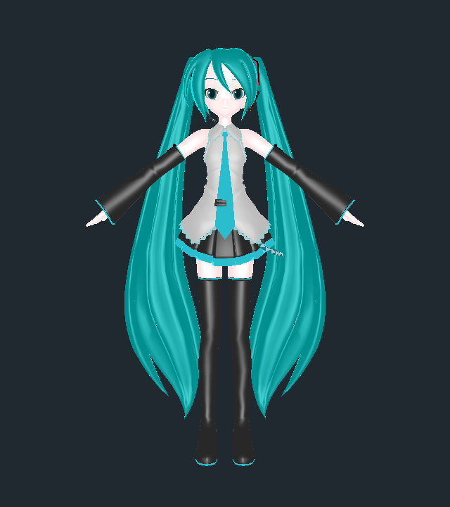
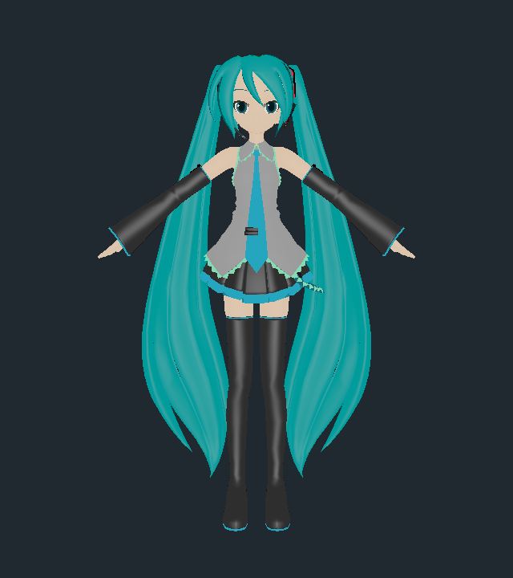
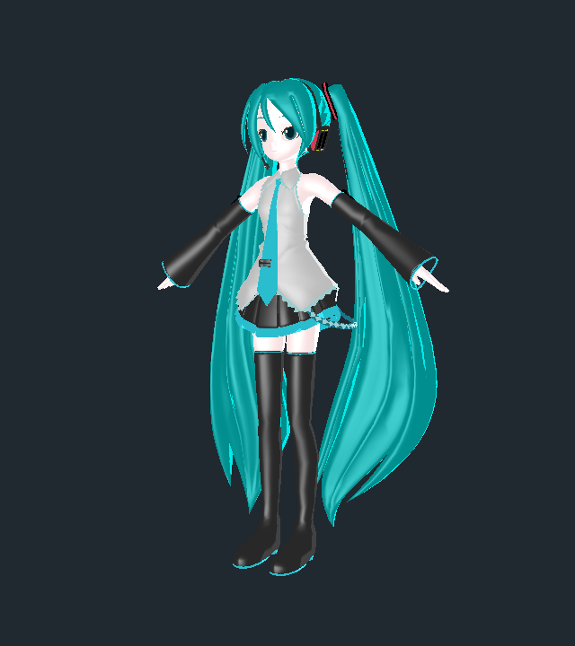
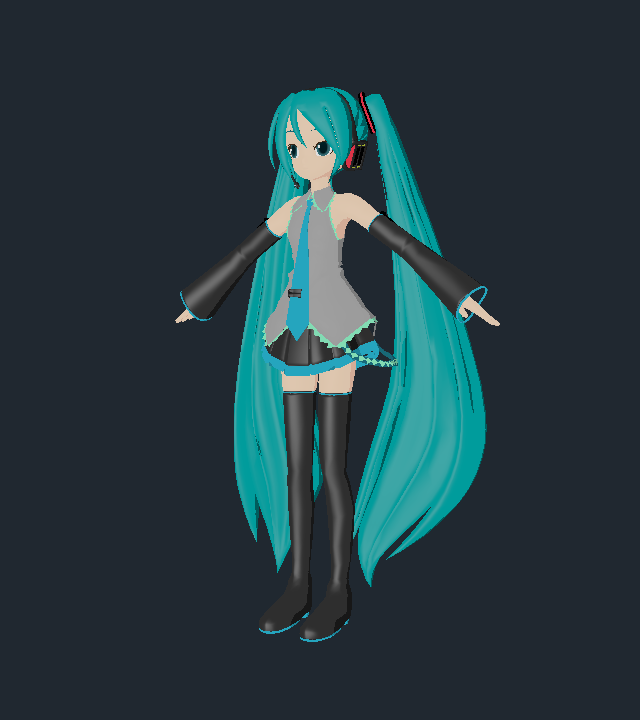

# Animasa Toon compatibility and validation — Issue #15

Animasa now opts into `AnimasaToonPlugin`, a renderer adapter for this repo's
verified PMD conversion. It matches the relevant direct-light composition of
[`three-mmd-loader` at 7b604fb](https://github.com/takahirox/three-mmd-loader/blob/7b604fb1d76b26a2c46bced0cbeab2b8b5781c40/src/materials/MMDToonMaterial.ts).
Uka still uses the original `MMDToonPlugin`. The `mmd-gltf` dependency remains
pinned to `3dfa726aa38992a1f7d5ea17b377c685e839e8b8`; its documented extension
contract and converter are unchanged. This isolated adapter needs no upstream
change, cross-repository branch, or new extension property.

## Composition and texture boundaries

For the adapter's single direct light, without scene indirect light or shadows:

```text
c = clamp(0.5 * dot(N,L) + 0.5, 0, 1)
surface = (decode(D) * lightRGB + 0.5 * decode(A)) * baseSampleLinear * rampSampleLinear
H = normalize(L + V)
specular = decode(P) * lightRGB * max(dot(N,H),0)^shininess
linearRGB = surface + specular
displayRGB = rendererOutputTransfer(linearRGB)
```

`D`, `A`, `P` and shininess are the untouched PMD diffuse, ambient, specular and
power fields from the GLB extension. `decode` is the sRGB EOTF. The ambient
coefficient applies **after** decoding: `0.5 * decode(A)`. The specular power is
not normalized, attenuated or multiplied by base/toon textures. For positive
power a zero half-vector contributes zero; zero power contributes constant
authored specular, following the reference. All shipped powers are positive.

Base and Toon images use separate `SRGBColorSpace` texture sources/views with
`flipY=false`. Three decodes their RGB at sampling, including the host's sRGB
filtering boundary; alpha stays linear. No additional shader sample decode or
final-result decode is applied. The shader returns linear HDR without the old
intermediate/final RGB saturation; the renderer converts to display sRGB once.
This follows the reference's identity sampler controls; Animasa has no material
morph controls, sphere layer or alternate UV set. Unsupported uses of this
specialized adapter fail rather than imply general extension conformance.

The original plugin instead composes encoded components, uses ambient coefficient
1, clamps before/following texture/specular operations, and decodes the final
encoded result. Its default behavior remains covered by a separate GPU probe.
The adapter inherits its material/alpha/outline metadata integration and resource
validation; it replaces the fragment graph and owns its independent texture
views until disposal. GLTFLoader's final clones retain the compatibility marker
and source factors. Runtime inspection rejects any mesh with a missing Toon
fragment graph or Animasa compatibility marker, and exposes counts and source
specular in Diagnostics.

### Actual embedded ramps

The PNGs are white at their top and dark at their bottom. The reference loader
rotates them **+90 degrees** and samples `(c,0)`. The equivalent original image
row is `1-c`, not `c`. The adapter resolves the nearest texel in the rotated
axis, then samples the center of that original row. This also resolves nearest
sampling ties consistently at exact bin boundaries without editing image bytes.
It uses nearest filtering without mipmaps, matching the reference ramp sampler.

| N·L | Coordinate c | Original 32px row |
| --- | --- | --- |
| -1 | 0 | 31 (dark) |
| -0.5 | 0.25 | 23 |
| 0 | 0.5 | 15 |
| 0.5 | 0.75 | 7 |
| 1 | 1 | 0 (white) |

The dark RGB endpoints are `(205,205,205)` for toon01, `(245,225,225)` for toon02,
and `(154,154,154)` for toon03; every top endpoint is `(255,255,255)`. Tests
decode the actual GLB images and compare these rows to a separately rotated
image. GPU tests additionally sample an asymmetric four-row color ramp at nine
dot products, so a reversed ramp or old full-dot mapping fails.

The adapter clamps the endpoints, preserving the GLB ramp wrapping. The
reference uses repeat wrapping, which wraps exactly `c=1` to its dark first
column. This isolated boundary difference is intentional: a fully lit normal
selects the intended white endpoint. The captures below do not establish
equivalence at that seam or every possible filtering edge.

## Controlled model comparison

Validated 2026-11-02 with Node 26.12.1, npm 11.20.0, Three.js 0.187.0 and isolated
headless system Chrome 156 on macOS. Both native WebGPU and WebGL backends were
explicitly checked. [Machine-readable results](animasa-shading/report.json)
include all 17 materials' preserved specular factors and per-backend metrics.

The original source is the same pinned `miku_v2.pmd`, SHA-256
`45a5a2fb897266a1b371b30cf53ed9435d375ddea9fce7f095bba2739b9bdae5`, with its exact
eye BMP. The unmodified published GLB remains 1,220,308 bytes with SHA-256
`cc3bd0a0c5620a248dda1bbb8b7e2c97aab7c8d863ef9a6add817bd56311cc07`.
Reference PMD scale is 0.08, matching the GLB's converted coordinates.

All three renders use the source rest pose, no physics/retargeting, a 640×720
canvas, 40° perspective, near/far 0.1/100, target `(0,0.8,0)`, front camera
`(0,0.96,2.8)` and oblique camera `(1.5,0.96,2.6)`. White directional light has
intensity 1 and world direction **`(0,0,1)`**, the unchanged `createToonLighting()`
default. The reference uses that same controlled input. The reference demo's
different light direction and scene ambient are deliberately excluded from this
material comparison. No scene-light position or intensity in this application
was changed. Outlines, fog, shadows, indirect lights and tone mapping are
excluded from this harness; the production smoke exercises outlines and physics.

| View | Before | After | Reference |
| --- | --- | --- | --- |
| Front |  |  |  |
| Oblique |  |  |  |

Float RGBA linear targets are read back before output conversion. Metrics use
the model silhouette union with background excluded, preserving black material
pixels and raster edges. No exposure/brightness fitting or image alignment is
applied. Each model's linear target also supplies display-white/clipping counts.

| Backend/view | Mean absolute linear RGB error, before → after | Pixels with error >0.01, before → after | Pixels reaching display white, before → after |
| --- | --- | --- | --- |
| WebGPU/front (105,183 model pixels) | 0.082275 → 0.000000187 | 83,289 → 0 | 3,724 → 0 |
| WebGPU/oblique (87,604) | 0.098131 → 0.000000298 | 68,061 → 1 | 3,470 → 0 |
| WebGL/front (105,183) | 0.082278 → 0.000003487 | 83,290 → 1 | 3,724 → 0 |
| WebGL/oblique (87,604) | 0.098130 → 0.000000381 | 68,056 → 0 | 3,470 → 0 |

WebGPU front mean linear luminance changes from 0.307893 to 0.251222, versus
0.251222 for the reference; oblique changes from 0.318134 to 0.240084, versus
0.240084. Skin loses the old broad white clipping, and shirt/hair shading moves
close to the reference. The authored sleeve/boot highlights remain visible.
The shader now adds those highlights in linear space after surface modulation,
rather than adding source components before decoding the combined color.
For example, source specular 0.4 still has isolated display peak 0.4 and linear
peak 0.132868, with its original power 15; there is no arbitrary specular scale.

Remaining measured differences include a WebGPU oblique pixel with maximum RGB
error 0.014783 and a WebGL front pixel with error 0.719211. Very small mean errors
coexist with these outliers; the unmodified PMD and converted GLB have separate
geometry/normal/skin representations and shader arithmetic. Their exact causes
were not isolated. The sampler endpoint difference above and reference demo
indirect-light/shadow behavior also remain. These captures show this controlled
renderer comparison, not pixel-perfect agreement with the original MMD program.

## Checks and reproduction

| Mandatory pre-merge check | Actual result |
| --- | --- |
| `npm ci` | Pass; 62 packages audited, zero known vulnerabilities reported. |
| `npm test` | Pass: 15 tests, one existing optional exact-source conversion skipped. |
| `ANIMASA_SOURCE=.cache/animasa-source npm test` | Pass: all 16 tests, including two byte-identical exact-source conversions, source identity, retargeting, physics and cleanup. The published GLB was not replaced. |
| `npm run build` | Pass: type checking and production bundling; existing large-chunk warning remains. |
| `npm run check:pages` | Pass: 23 reviewed files, 44.0 MB; all original asset/notice hashes intact. No allowlist changes. |
| Controlled GPU probes/comparison | Pass on native WebGPU and WebGL: 45 linear samples and one independent final sRGB output sample per backend; no page/console errors. |
| Production-prefix `npm run test:browser -- --animasa` | Pass: actual automatic GLB, runtime Toon/compatibility markers and all source specular factors, physics on/off, valid/invalid/local override, cancellation and switching, missing/corrupt resources and retry, input/blur, 390px layout, network/LFS/missing weights and WebGL fallback. |
| Production-prefix `npm run test:browser -- --mmd` | Pass: same regressions with Uka as the main physics target; Uka runtime compatibility remains `default`. |
| Diff, Markdown links and whitespace | Reviewed before commit. |

The linear probes independently compute expected sRGB EOTF values, test colored
diffuse/base/toon/light and authored ambient with specular on/off, powers 0/8,
front/back/grazing normals, sample alpha, zero half-vector, an unclipped HDR value
of 2.5, and the unchanged default extension equation. A separate encoded output
readback detects missing/double output conversion. The complete-model comparison
also tests actual embedded texture selection and sampling on the runtime plugin.

The browser evidence is summarized in [browser-report.json](animasa-shading/browser-report.json).
The [production screenshot](animasa-shading/demo-after.png) shows automatic Animasa
loading with outlines and physics before inference. Full motion inference was
not rerun: no inference/retargeting/IK/physics code changed, no verified model cache
was present in this worktree, and the smoke deliberately tests model-load failures.
The exact-source physics/retargeting regressions did run. Other GPUs/browsers and
fresh real-model inference are optional, unperformed validation.

To reproduce the controlled comparison, place the six exact files from
`scripts/animasa-manifest.json` under `.cache/animasa-source` (the converter's
documented source layout). Acquire a read-only reference checkout:

```sh
git clone https://github.com/takahirox/three-mmd-loader.git .cache/three-mmd-loader
git -C .cache/three-mmd-loader checkout 7b604fb1d76b26a2c46bced0cbeab2b8b5781c40
npm ci
npm run dev -- --port 5186
# In another terminal; CHROME_BIN is optional if Playwright Chromium is installed:
CHROME_BIN='/Applications/Google Chrome.app/Contents/MacOS/Google Chrome' \
  node scripts/compare-animasa-shading.mjs
```

The driver checks the clean reference commit and PMD/eye sizes/hashes before
running. It imports the actual reference TypeScript via Vite, using this app's
single Three.js instance for both renderers. No reference install or build is
needed. It writes the six comparison PNGs and `report.json` under
`docs/animasa-shading/`. Neither the development harness nor reference sources
enter the production bundle or Pages assets.

For production regression reproduction, run `npm run build`, then
`npm run preview -- --port 4186` and, in another terminal:

```sh
CHROME_BIN='/Applications/Google Chrome.app/Contents/MacOS/Google Chrome' \
  DEMO_URL=http://127.0.0.1:4186/three-motionbricks/ npm run test:browser -- --animasa
CHROME_BIN='/Applications/Google Chrome.app/Contents/MacOS/Google Chrome' \
  DEMO_URL=http://127.0.0.1:4186/three-motionbricks/ npm run test:browser -- --mmd
```

The additional validation uses the existing Playwright and sharp dependencies;
no CI browser/download requirement was added. Attach/link this report and its
screenshots when the checkpoint is published to a PR. This node did not push,
open a PR, comment, merge, or deploy.

Required post-merge verification for Issue #15: **None required**. This local
result makes no published-origin or deployment claim; the separate Issue #13
publication follow-up remains outside this change.
