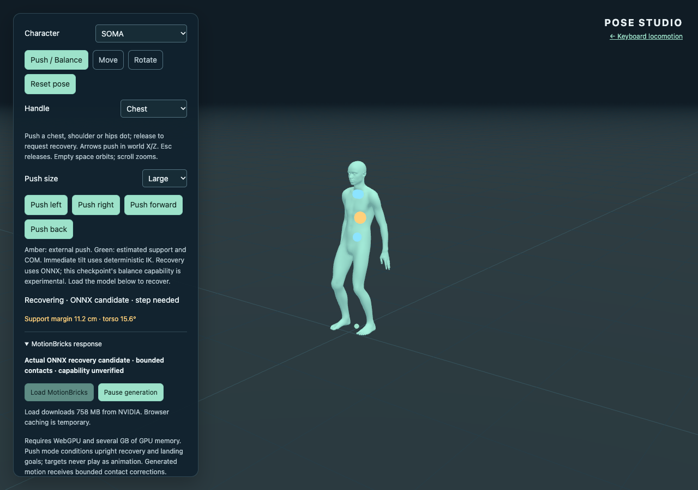
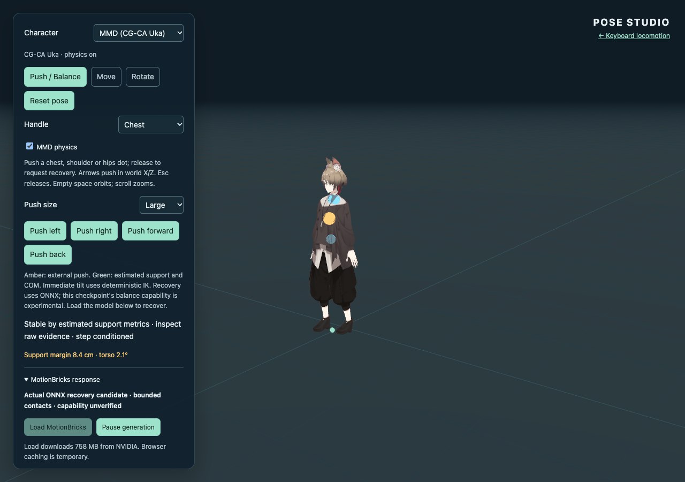
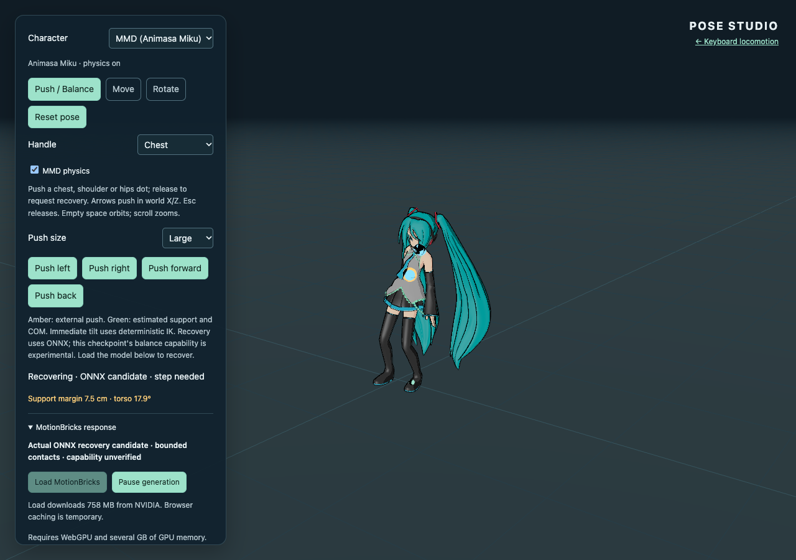

# Issue #19 continuation after PR #20

Work on 2026-11-05 starts from checkpoint
`dadfaa36d233a835a21a26547a9d65f336e4f52d`, which retains merged PR #20
(`3b46a9dd300e6d766542cc1407e427842af7e7d1`) and its dated publication evidence.
[Earlier local inference](balance-validation.md) and
[earlier publication checks](balance-public-validation.md) remain separate.
Issue #19 remains open while required behavior or public-origin inference is
unverified. This continuation does not push, publish, open a PR, merge or comment.

## Conditioning experiment

The first step request retains the existing lifted full-body intention. The
second retains its grounded landing. Subsequent requests ground the **observed**
landing: planted feet keep their anchors; released feet use their current
horizontal positions. The upright target centers over those feet with 2.5 cm
of pelvis lowering to keep the leg targets reachable. Each ankle target may be
lowered by the latest decoded endpoint's excess ankle height, capped at 1 cm.
This is a bounded conditioning experiment, not an additional correction to
played animation. The geometric touchdown, safety and stability thresholds,
eight-frame seam, 0.18 rad contact correction and 2.5 cm root budget remain
unchanged. Goals are never enqueued for playback.

Continuing context is the controller's actual observed displayed history,
including its existing seam/contact contribution; conditioning goals never
replace it. Focused tests verify this distinction and confirm that computing
settling goals neither moves the display nor changes contact state. Reset and
new pushes clear the saved raw endpoint so another episode cannot inherit its
conditioning bias.

Fresh diagnostics retain output channels 362–365 before clamping, in the order
left heel, left toe, right heel, right toe. These are model confidences, separate
from geometric contact inference; they do not authorize additional IK. This
layout and the possibility of confidence outside [0,1] follow the pinned
[NVIDIA model card](https://github.com/NVlabs/motionbricks/blob/54fc563aeaaf819a753d72cc9fdc6713989cdd43/docs/soma_model.md)
and [contact implementation](https://github.com/NVlabs/motionbricks/blob/54fc563aeaaf819a753d72cc9fdc6713989cdd43/motionbricks/animation/foot_contacts.py).

The revised feasibility reporter requires the final **12 raw frames** (0.4 s)
to have both geometric contacts, support margin above 5 mm, torso tilt below
0.1 rad and maximum COM speed below 7 cm/s, alongside stable display. It records
raw final ankle heights, model contact predictions when available, raw tail
speed, and raw versus corrected margins. A final upright frame alone cannot
pass this settling criterion. Step evidence still additionally requires raw
lift above 3.5 cm and travel above 12 cm. `--feasibility` means integration can
complete with limited cases; it is not a capability pass.

## Reproduction

```sh
npm ci
npm run assets:model # Interrupted transfers preserve .onnx.part; rerun to resume.
npm run build
npm run check:pages
npm run preview # Keep running on port 4173.
# Full candidate sweep, sharing verified weights with the public-origin run:
CHROME_BIN='/Applications/Google Chrome.app/Contents/MacOS/Google Chrome' \
  MODEL_CACHE="$PWD/public/assets/mmm_v6_soma_fp32.onnx" \
  DEMO_URL=http://127.0.0.1:4173/three-motionbricks/ \
  BALANCE_OUTPUT=.artifacts/balance-followup/candidate \
  npm run test:balance -- --model
# Already published PR #20, not the unmerged candidate:
CHROME_BIN='/Applications/Google Chrome.app/Contents/MacOS/Google Chrome' \
  MODEL_CACHE="$PWD/public/assets/mmm_v6_soma_fp32.onnx" \
  DEMO_URL=https://takahirox.github.io/three-motionbricks/ \
  BALANCE_CASES=small-left,large-right,large-forward,uka-back \
  BALANCE_OUTPUT=.artifacts/balance-followup/public \
  npm run test:balance -- --model
```

`MODEL_CACHE` verifies the complete pinned size/hash before starting its local
streaming server. Only the model URL receives a test-only redirect. Production
worker, WASM and character requests remain at the tested origin. This validates
cache-assisted inference, separately from end-to-end production model delivery.
Chrome 157 initially blocked a public-origin-to-loopback transport probe.
Granting `local-network-access` for `https://takahirox.github.io` in the isolated
test context made the same text-only probe succeed. No model inference was
performed by that probe. HTTPS cache-assisted sweeps record this scoped test
permission; they do not change ordinary user profiles or production behavior.
The source pin, model precision, provider and tensor contract remain unchanged.

A separate opt-in `npm run test:balance:conditioning` uses the dev server on
port 5173 and the same verified `MODEL_CACHE`. It compares fixed landing goals
with observed landing goals for large forward, backward and lateral pushes.
Both variants share an identical eight-sample disturbance and drain each
response before generating from its actual corrected controller history.
Controller time holds during inference. Its raw/conditioned/corrected traces
are real ONNX outputs at fixed 30 Hz, but the measured controller is **not
rendered or retargeted** in this harness. These results isolate conditioning
from wall-clock sampling; they cannot replace interactive demo or public-origin
runtime evidence. There are no fabricated inference results or authored
recovery clips. The harness records capability failures as failures in each
case, with an integration completion label only.

## Fresh results, 2026-11-05

[Machine-readable results](balance-followup-validation.json) contain source hashes,
model identity, actual runtime/GPU data, per-generation summaries and all case
metrics. [Rendered forward/back traces](balance-followup-traces.json) retain
348 raw decoded frames, rotations, conditioning/context poses, predicted foot
confidences and actual displayed samples. [Causal comparison traces](balance-conditioning-traces.json)
retain the forward/back fixed-versus-observed branches. Both variants really ran
ONNX; their first two contexts, targets and decoded outputs were exactly
identical in the full-precision reports, including contact outputs. Those prefix
motions are stored once per direction in the compact checkpoint data; each
variant's measured inference timings are retained separately. Saved numeric traces are
rounded to six decimals. No pre-merge inference trace is relabeled as fresh.

### Complete verified model delivery

At 13:37:50 UTC, the assembled file was exactly **757,864,273 bytes** and matched
SHA-256 `856419dc72aeb14e591eebf4dd0ea05734a2506ddb00bcd39dd6dac2ad60f4fb`.
`npm run assets:model` independently reverified it and reused it without another
transfer. No complete cache was found in the known project locations initially.

A five-minute single-connection attempt retained 33,979,959 bytes. A successful
1 MiB probe led to four 1 MiB media-host range workers, preserving completed
ranges. A measured official Git LFS download endpoint provided the same pinned
object; the final bounded attempt used **two connections per official endpoint**,
reused all completed ranges, and finished 691 ranges in **2,884.594 seconds** with
no failed requests. The exact range headers and final complete hash were checked.
This differs from the earlier failed twelve-way 4 MiB attempt. Partial files and
range data remain ignored locally; the JSON records a cache workspace hint for
later nodes, which must reverify the hash before reuse if that worktree survives.
Weights are excluded from the checkpoint and
Pages build. The ordinary browser's end-to-end production download remains
unverified. Complete cache delivery and runtime execution are recorded separately.

### Actual public-origin PR #20 runtime

The public baseline run finished at **13:40:32 UTC**, using Chrome
157.0.8103.38, Apple Metal 3 WebGPU and ORT Web 1.31.1 with its normal WASM
fallback. The actual production URLs
`assets/inference.worker-B2nxauak.js` and
`assets/ort-wasm-simd-threaded.asyncify-AkdHdxrx.wasm` returned 200 and executed
an ONNX session. The verified cache supplied exactly one complete model response;
load/session creation took 42.4 seconds. There were no page or network errors.
A focused application-bundle identity check also matched the earlier merge-build
SHA-256 for `pose-BZ2tgfOJ.js`; the full 27-file sweep was not repeated.

All four selected cases generated real responses, including Uka. **The strict
smoke command failed** its raw-step-and-settling assertion, and is not reported
as passing. Its later repeated-push/reset and mobile checks were not reached.
The successful earlier asset/navigation checks remain separately dated evidence.

| Public baseline case | Sequences | Raw / displayed final support margin | Outcome |
| --- | ---: | ---: | --- |
| Small left | 2 | 11.1 / 11.0 cm | Raw support/contact settling passed |
| Large right | 6 | −16.3 / 7.8 cm | Generated lift/travel; display stable, final raw contact absent |
| Large forward | 6 | −7.2 / −7.2 cm | Explicit generation limit |
| Uka back | 6 | −9.7 / −9.5 cm | Explicit generation limit |

Thus the earlier transport blocker is resolved for cache-assisted public-origin
runtime verification, while the published fixed landing strategy still exhibits
measured recovery limitations. Earlier successful lateral trials are retained;
this fresh differing trial demonstrates sensitivity to actual response history
and scheduling rather than a guaranteed success rate.

### Controlled real ONNX comparison

The six fixed-step experiments completed at **13:41:08 UTC** with no page errors.
The first two generations are identical within each pair; only later recovery
conditioning changes. Both variants continue from their own actual corrected
controller history. These are controller integration experiments, **not rendered
or MMD-retargeted evidence**.

| Direction | Fixed landing | Observed landing | Raw final support margin, fixed → observed |
| --- | --- | --- | ---: |
| Forward | Limited after 6 sequences | Raw support/contact settling in 4 | −8.1 → 7.8 cm |
| Back | Limited after 6 sequences | Raw support/contact settling in 3 | −6.3 → 7.8 cm |
| Right | Settled in 3 | Settled in 3 | 7.4 → 7.8 cm |

Even failed fixed-landing endpoints reported heel/toe model confidences above
0.91 while geometric contact was absent. Model confidence alone would hide this
failure; it is intentionally neither substituted for geometric contact nor used
to grant more IK authority. This comparison supports the combined observed
landing strategy; it does not isolate the ankle-bias component independently.

### Rendered candidate: all nine cases

The production-prefix candidate sweep completed at **13:42:54 UTC**. Its command
passed, and **all nine cases** separately passed the raw support/contact settling
criterion. Six medium/large cases additionally passed generated-step criteria.
The cache served one complete model; there were no page or network errors.
SOMA, Animasa and Uka retained visible body motion, physics, reset/switch behavior,
repeat-push stale-result rejection and the narrow-screen checks.

| Candidate case | Sequences | Raw ankle lift | Raw foot travel | Raw / displayed final support margin |
| --- | ---: | ---: | ---: | ---: |
| SOMA small left | 2 | none | 2.3 cm | 11.2 / 11.0 cm |
| SOMA medium right | 3 | 4.8 cm | 12.6 cm | 10.4 / 10.0 cm |
| SOMA large right | 5 | 4.9 cm | 22.0 cm | 11.0 / 10.5 cm |
| SOMA large forward | 3 | 4.3 cm | 20.4 cm | 9.1 / 8.3 cm |
| Animasa small left | 2 | none | 2.2 cm | 11.1 / 10.9 cm |
| Animasa large right | 5 | 4.8 cm | 21.2 cm | 11.0 / 10.5 cm |
| Uka small left | 2 | none | 1.7 cm | 11.2 / 11.0 cm |
| Uka large right | 4 | 4.9 cm | 17.9 cm | 7.9 / 7.9 cm |
| Uka large back | 3 | 6.0 cm | 13.8 cm | 8.9 / 8.4 cm |

Lift/travel retain the earlier definitions: canonical ankle height relative to
initial standing, and first-to-final horizontal travel of the more mobile foot.
Raw forward torso tilt decreased from 19.11° to 2.08°; backward from 15.41° to
2.08°. Forward raw chest/hip/hand travel reached 13.8 / 14.2 / 25.9 cm; backward
14.1 / 13.9 / 46.5 cm. These are generated full-body changes before contact IK,
not MMD secondary motion or a root-return interpolation.

The maximum displayed contact correction was 0.18 rad; the largest root
correction was **1.13 mm**, in the forward case. Torso/arm rotations remain outside
contact IK authority. The unchanged player seam still contributes its separate
eight-frame fade, and continuing context includes the resulting actual display.

**Residual limitation:** support/contact settling is a kinematic estimate, not
proof of perfectly motionless raw feet or physical force balance. Across the
last 12 raw frames, forward feet still travel within 3.0 / 5.8 cm ranges and
backward within 3.3 / 6.0 cm; maximum instantaneous ankle speeds reach 0.23 / 0.25
m/s. Bounded contact correction and endpoint holding remain visible contributions
to the displayed stance. These residuals are recorded alongside the successful
raw COM/support/contact criterion and generated lift/travel; they are not hidden
by the word stable. Robust no-slip contact would need further contact/velocity
conditioning or an explicitly labeled contact controller/policy, with perturbed
standing/recovery training if the checkpoint cannot satisfy it. No universal
recovery or native external-force policy is claimed from these trials.







## Checks and remaining acceptance

- Fast tests: **36 passed, one existing optional `ANIMASA_SOURCE` test skipped**;
  approximately 2.5 seconds. New coverage verifies observed landing conditioning,
  actual corrected history, no target playback, range/resume/hash guards and
  verified cache streaming. The existing motion/IK/retarget/physics checks remain.
- Type/production build and Pages artifact check passed: 27 files, 44.1 MB;
  no weights or partial files published. No dependency or license changed.
- Development and production-prefix balance interaction smoke passed; original
  pose editor smoke passed on all three characters; keyboard smoke passed.
- Public real ONNX runtime completed the four selected cases but **failed** the
  strict capability assertion. The six causal experiments completed with the
  fixed versus observed outcomes above. The nine-case rendered candidate real
  ONNX sweep passed. The tests reuse one verified model, not repeated downloads.
- Documentation links, complete source diff and whitespace are checked separately
  from runtime validation. Browser/model checks remain opt-in; CI does not fetch
  weights or install a GPU browser.

**Issue #19 remains open (Refs #19).** This is improved conditioned recovery
feasibility, with residual raw foot motion explicitly retained. Required
post-merge acceptance remains pending: publish this follow-up through the normal
workflow, verify its exact public bundle and worker/WASM, repeat actual public
small/large and forward/back ONNX responses and check all three characters,
resources and navigation. The fresh public evidence above targets merged PR #20,
not this unmerged candidate. Do not mark the Task finished based on this local
candidate or silently omit those public checks and contact limitations.

Publication retries remain zero. No connector upload was retried; no push, PR,
merge, comment, deployment dispatch, provider/model change, usage reset,
allowance purchase, port 8765 change or Project mutation was performed.
