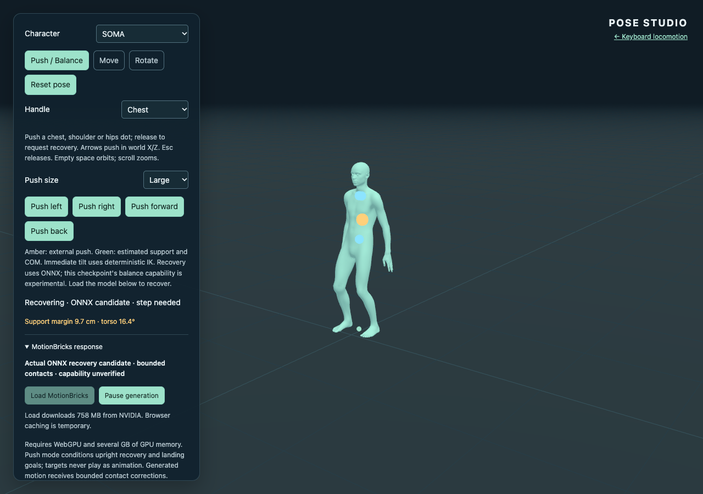
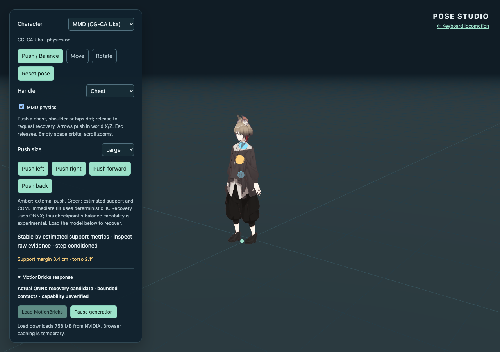
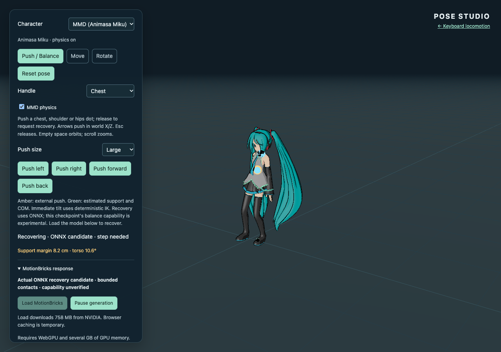

# Issue #19: PR #21 post-merge verification

Fresh verification on **2026-11-05**, completed at **14:17:20 UTC**, targets merged
[PR #21](https://github.com/takahirox/three-motionbricks/pull/21), merge commit
`e4aa44e59471929febdfc703475b5f8d1ec7bb55`, reviewed head
`01fca7f889cff404e89de126b6b736c8e7e29b0e`.

The required deployment and public-origin recovery checks passed. This establishes
the requested examples of conditioned generated recovery, including forward and
backward stepping, with the controller contributions and residual raw foot motion
below. It does not establish a native force policy, universal recovery or
motionless raw feet. No implementation correction or additional PR was needed.

[Machine-readable verification](balance-merged-validation.json) retains deployment,
all public resource hashes, model delivery, runtime, per-generation summaries,
raw versus displayed measurements and regression results.
[Fresh complete representative traces](balance-merged-traces.json) retain all
754 raw frames for small left, large right, large forward and Uka backward:
decoded rotations/joints, actual contexts, conditioning targets, predicted contact
confidences and displayed samples. These are new public-origin responses after
the merge, not relabeled candidate results. Earlier
[PR #20 publication checks](balance-public-validation.md) and
[pre-merge continuation experiments](balance-followup-validation.md) remain dated
evidence with their original failures and incomplete results.

Issue #19 was **closed as completed at 14:21:26 UTC** after these checks. The
[Issue outcome comment](https://github.com/takahirox/three-motionbricks/issues/19#issuecomment-6660347411)
references PR #21 and retains the residual limits and cache-delivery distinction.

## Deployment and exact resources

- The merge-triggered [Pages run](https://github.com/takahirox/three-motionbricks/actions/runs/42041687578)
  passed its hosted tests, production build, artifact guard and deployment for
  the actual merge SHA. No workflow was dispatched or retried.
- Current runtime, tests and character resources match the merge. All ten saved
  candidate source hashes also match. A fresh local build and Pages artifact
  check passed; unrelated heavy suites were not repeated.
- **All 27 public files, 44,066,538 bytes**, returned HTTP 200 and matched the
  merge build by SHA-256. This includes both HTML entries, `pose-CGQYfjlh.js`,
  worker, WASM, three character assets, physics runtime, notices and licenses.

## Complete verified model and actual public session

The previous cache worktree was no longer present. No complete payload was found
in the known Run/project cache locations. A five-minute repository downloader
attempt retained **132,514,935 bytes** before its transfer deadline. This was a
transport timeout, not a model capability result.

A 1 MiB official Git LFS probe returned the exact requested range in 1.638 s.
The subsequent bounded transfer used **two official LFS and two pinned media-host
connections**, 1 MiB ranges and a 900-second budget. It reused the prefix and
probe, verified every response range and completed in **144.042 seconds** with
no failed requests. The assembled **757,864,273-byte** payload matched SHA-256
`856419dc72aeb14e591eebf4dd0ea05734a2506ddb00bcd39dd6dac2ad60f4fb`.
The verified cache helper independently checked size/hash before serving it.
Weights, partial data and range files remain ignored locally, outside the
checkpoint and Pages artifact. Any later reuse must reverify the pinned hash;
this worktree's lifetime is not guaranteed.

The public run used HeadlessChrome **157.0.8103.38**, Apple **Metal 3 WebGPU** and
ORT Web **1.31.1**, preserving the normal WASM fallback and model/provider settings.
Session loading took **13.205 s**. The production-origin URLs
`assets/inference.worker-B2nxauak.js` and
`assets/ort-wasm-simd-threaded.asyncify-AkdHdxrx.wasm` returned 200 and executed
the actual ONNX session. There were **29 generated responses**, no page errors
and no failed network requests.

**This was cache-assisted public inference.** Only the model request received a
test-only redirect to the complete verified streaming cache, which served exactly
one full payload. Application, worker, WASM and character resources came from
`https://takahirox.github.io/three-motionbricks/`. Chrome local-network access was
granted only in the isolated test context. Ordinary end-to-end browser delivery
from the production model URL remains unverified; no redundant full download was
started. Complete official payload delivery and public runtime execution are
recorded separately.

## Fresh generated recovery measurements

The strict public command passed without `--feasibility`. Each of the **nine**
cases independently passed the raw tail criterion: the final 12 raw frames have
both inferred geometric contacts, COM support margin above 5 mm, torso tilt
below 0.1 rad and maximum COM speed below 7 cm/s, with stable display. A generated
step additionally requires raw ankle lift above 3.5 cm and foot travel above
12 cm. The medium case settled but its 8.8 cm travel did **not** meet that step
criterion; five large cases did. These are measured trials, not a success-rate
guarantee. Model heel/toe confidences are retained independently from geometric
contact and do not authorize additional correction.

| Public case | ONNX sequences | Raw lift | Raw foot travel | Raw / displayed final support margin | Generated step |
| --- | ---: | ---: | ---: | ---: | --- |
| SOMA small left | 2 | none | 2.3 cm | 11.2 / 11.0 cm | No |
| SOMA medium right | 3 | 4.8 cm | 8.8 cm | 11.4 / 10.9 cm | No |
| SOMA large right | 5 | 4.9 cm | 22.5 cm | 11.1 / 10.5 cm | Yes |
| SOMA large forward | 3 | 4.4 cm | 19.9 cm | 8.7 / 8.0 cm | Yes |
| Animasa small left | 2 | none | 1.9 cm | 8.7 / 8.8 cm | No |
| Animasa large right | 4 | 4.9 cm | 21.1 cm | 8.0 / 8.0 cm | Yes |
| Uka small left | 2 | none | 1.7 cm | 11.2 / 11.0 cm | No |
| Uka large right | 5 | 4.8 cm | 21.7 cm | 11.0 / 10.5 cm | Yes |
| Uka large back | 3 | 13.8 cm | 14.1 cm | 9.0 / 8.4 cm | Yes |

Lift is canonical ankle height above initial standing; travel is the larger
first-to-final horizontal ankle displacement. Small-left raw hands moved
8.5 / 7.0 cm while feet traveled 2.3 / 1.2 cm. Forward raw torso tilt fell from
19.68° to 2.16°, with chest/hip/hand travel of 13.3 / 13.6 / 27.1 cm. Backward
tilt fell from 16.79° to 2.07°, with chest/hip/hand travel of
20.6 / 20.6 / 37.9 cm. Generated lift, placement and full-body changes are
measured before seam/contact correction and before MMD secondary physics.

The immediate imposed disturbance remains deterministic IK. Conditioning goals
never play as animation; continuing generations use actual displayed history.
After release, ONNX supplies torso/arm/leg motion. The existing eight-frame seam,
bounded leg-contact correction and endpoint holding remain explicit contributions
to display. Maximum measured contact correction was **0.1630 rad** and maximum
root correction **0.943 mm**, below the unchanged 0.18 rad / 2.5 cm budgets.
Torso and arms remain outside post-generation contact IK authority.

**Residual raw-contact limitation:** in the last 12 raw frames, forward feet
still span 2.7 / 5.8 cm horizontal ranges, reaching 0.24 m/s instantaneous ankle
speed; backward spans 3.0 / 6.0 cm, reaching 0.25 m/s. Thus passing the stated
COM/support/contact settling criterion does not prove no-slip raw feet or
physical force balance. The displayed stance also relies on the disclosed
contact correction and endpoint hold. Robust no-slip behavior remains a possible
extension requiring contact/velocity conditioning or a separately labeled
controller/policy, and potentially perturbed-standing training. It is not claimed
as a result of this verification. The requested successful generated recovery
examples and allowed bounded corrections are established without such a claim.







## Regression checks and reproduction

- The same public ONNX sweep passed initial planted disturbance, mouse push,
  Escape/release, repeated pushes during inference, character switching/reset,
  stale-result rejection and 390 px layout. All three characters generated
  small/large responses; MMD physics remained active.
- Public `test:pose` passed SOMA/Animasa/Uka Move/Rotate, hand/foot/hips editing,
  retained editor poses, physics disposal/restart, reset, mobile layout,
  missing-model handling, no-GPU fallback, both navigation links and browser
  history, with no page errors. The isolated test wrapper increased the default
  resource wait to **180 s**; the earlier 30-second Uka failure remains recorded
  in the earlier publication report.
- A focused public keyboard check passed W walk, Shift run and blur clearing
  intent, with no page or network errors. No second locomotion model download
  was needed. The merged hosted fast tests passed; their unchanged heavy suites
  were not redundantly rerun here.
- Saved source identity, JSON parsing, trace integrity, local evidence links and
  whitespace are checked separately from runtime validation.

```sh
npm ci
npm run build
npm run check:pages
CHROME_BIN='/Applications/Google Chrome.app/Contents/MacOS/Google Chrome' \
  MODEL_CACHE="$PWD/public/assets/mmm_v6_soma_fp32.onnx" \
  DEMO_URL=https://takahirox.github.io/three-motionbricks/ \
  BALANCE_OUTPUT=.artifacts/balance-merged/onnx \
  npm run test:balance -- --model
```

The Issue acceptance is satisfied for the measured conditioned-recovery scope;
the residual limits above remain part of its outcome. No synthetic response,
authored rescue clip, publication retry, connector upload, deployment dispatch,
force push, allowance reset/purchase, model/provider change, port 8765 change or
unrelated Project mutation was performed. These files are verification evidence
for the Run checkpoint, not another implementation publication.
