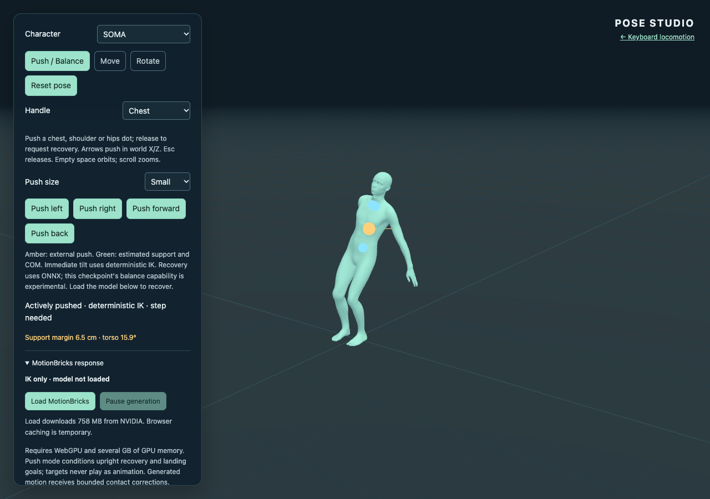
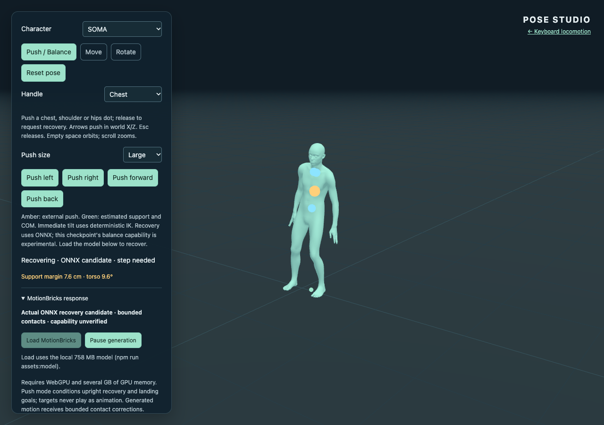
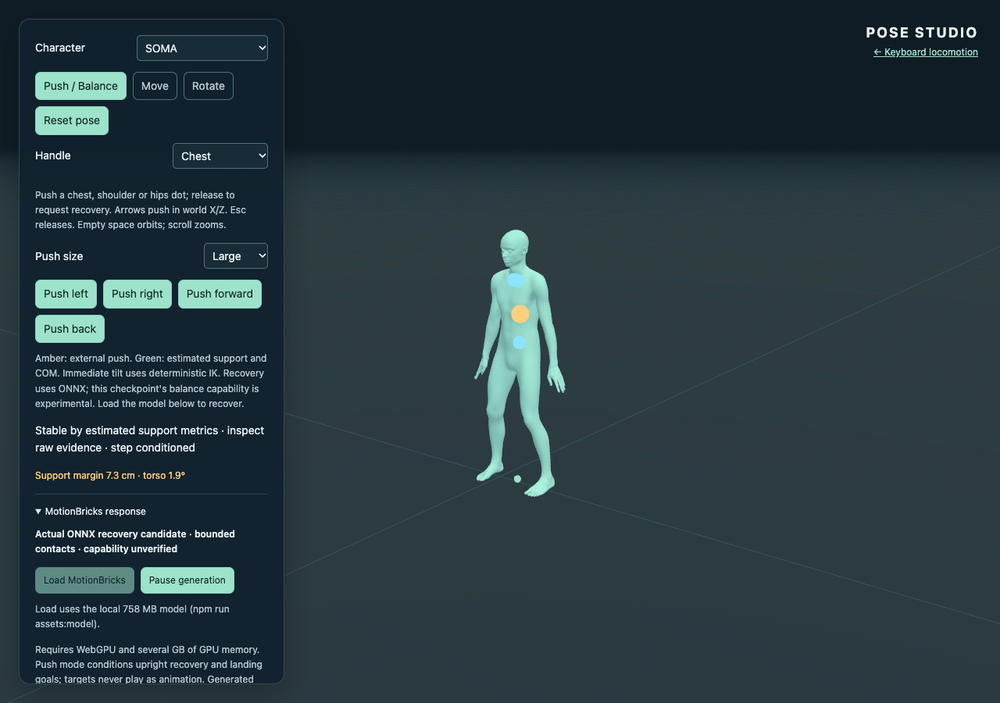
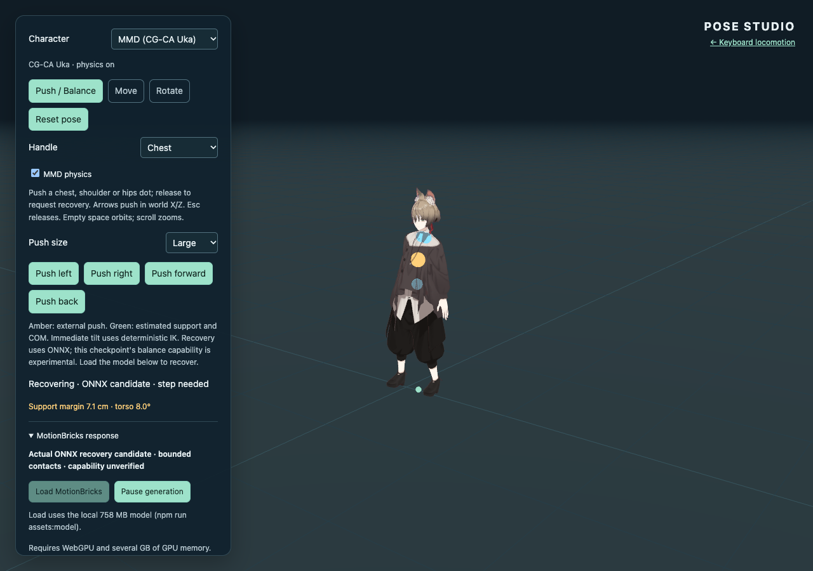

# Push / Balance recovery (Issue #19)

The new default mode in `pose.html` treats a body drag as an external disturbance.
The separate Move / Rotate editor and keyboard locomotion demo remain available.
This implementation demonstrates **conditioned ONNX lateral recovery**, including
raw generated foot lift and placement. It does **not** establish a checkpoint
trained for forces, robust recovery in every direction, or a physical simulation.

## Reproduce the interaction

Run `npm ci`, `npm run assets:model`, and `npm run dev`. Open `pose.html`, load
MotionBricks, select Small and Push left, then reset, select Large and Push right.
Repeat with Animasa Miku and Uka. Drag the Chest, either Shoulder, or Hips handle
for continuous input; release or Esc removes the external push. Arrows give world
X/Z pushes after focusing the scene. New pushes interrupt recovery; reset and
character switching clear obsolete inference and MMD simulation state.

Buttons ramp the imposed handle displacement over 240 ms: 7, 18 or 34 cm.
Horizontal displacement saturates at 38 cm; recent velocity saturates at 1.5 m/s.
The disturbance controller translates the pelvis by 0.32 times handle displacement,
lowers it by at most 15 cm, tilts pelvis/spine and counter-rotates the arms.
Knee flexion avoids the straight-leg IK singularity; planted-foot IK retains
support and level soles. Already airborne feet are not invented supports when
another push interrupts the response. This immediate behavior is labeled
**Deterministic disturbance IK**, not MotionBricks motion.



## Conditioning and control boundaries

Four actual displayed 30 Hz samples, including the disturbed pose, form the first
context. Release captures these samples before a slow inference can replace them
with four identical held poses. Following generations use the actual displayed
response history. The existing `encode`, worker, `decode` and revision-safe
`PoseResponse` / `MotionPlayer` path are reused, with the original seven tensors
and four full-body targets. No force-vector input is invented.

Small pushes condition an upright stance around the support origin. An estimated
capture point outside support by 2.5 cm, or displacement above 20 cm, requests a
step intention. Its first four conditioning poses request an upright body and
one foot lifted 7.5 cm toward a prospective landing 18–38 cm in the disturbance
direction. The next request conditions the grounded landing and standing torso,
using the actual response history. Heading is retained. These IK-authored poses
are **inputs only**; neither window is played or interpolated as a recovery clip.
The first window does not guarantee that ONNX will lift the foot; the sweep
measures its actual output independently.

After release no torso, arm, hips or dragged-joint target remains. ONNX controls
the full-body trajectory. Contact IK only adjusts planted leg chains, bounded by
**0.18 radians per joint and 2.5 cm root translation** relative to each generated
playback frame. Toe/body floor correction shares that budget. The pre-existing
player separately fades its seam correction over eight frames; that seam is not
part of the contact budget. Displayed traces include both contributions and
identify the generated sequence/frame for comparison with raw decoded frames.

Raw collapsed/teleporting, deeply penetrating (>2.5 cm below ground), excessively
tilted (>0.8 rad) or distant (>0.95 m from the episode origin) segments are rejected.
A separate displayed-frame guard freezes playback if seam/contact correction
crosses those bounds. Safety stops and six unsuccessful sequences stay explicitly
limited; they do not play a scripted rescue or claim recovery. Model-load failure
leaves posing and disturbance input usable. Without inference the released
character waits in the disturbed pose, labeled recovering/waiting for the model.

The stable phase requires a generated response, both inferred contacts, COM at
least 5 mm inside support, torso tilt below 0.1 rad, and COM speed below 7 cm/s
for 0.4 s, with playback drained. Settled motion drains rather than requesting
forever ahead. This is **displayed estimated stability**, not a raw-model success
claim: the stricter feasibility report assesses raw support/contact settling
separately. Reset can restore the authored stable stance without generation;
entering from an unstable editor pose requests recovery instead of labeling it
stable.

## Support and retargeting

The COM proxy is a mass-weighted sum of body-segment midpoints. Each contacting
foot contributes an 11 × 22 cm rectangle, rotated with heading; their convex hull
is support. A linear inverted-pendulum capture estimate adds horizontal velocity
scaled by `sqrt(COM height / 9.81)`. These are approximate kinematic indicators,
not calibrated anatomy or simulated contact forces.

Foot release follows generated lift (>4.5 cm) or horizontal drift (>6.5 cm).
Touchdown needs height within −2.5/+1.8 cm of the standing ankle height and speed
below 12 cm/s. Hysteresis permits coherent support switching without authoring a
swing. Contacts can still misclassify low-clearance sliding; therefore release
counts alone are insufficient evidence of a step. The measured step criterion
also needs raw foot clearance >3.5 cm, horizontal foot travel >12 cm, upright raw
settling with both inferred contacts and positive raw support margin, and stable
display. COM/support/contact traces remain available even for failures.

All interaction and conditioning stays on SOMA. Visible MMD body handles map back
by displacement and height ratio; final SOMA poses drive the existing retargeter.
Toon/outline, secondary physics, driving-bone authority, disposal and licenses are
unchanged. The support visualization and measurements are in canonical SOMA
space; foot support on differing MMD proportions is approximate. Body-joint
motion, rather than secondary jiggle, is measured before retargeting.

## Measured checkpoint feasibility

The pinned NVIDIA revision is `54fc563aeaaf819a753d72cc9fdc6713989cdd43`,
`mmm_v6_soma_fp32.onnx`, SHA-256
`856419dc72aeb14e591eebf4dd0ea05734a2506ddb00bcd39dd6dac2ad60f4fb`.
The local file was size/hash verified by `scripts/download-model.mjs`.
Measurements used installed HeadlessChrome 157, Apple Metal WebGPU, and ORT Web
1.31.1, including its ordinary WASM fallback for unsupported/shape operations.
These nine cases used the actual worker/session, with no fabricated inference,
played targets, manual root-return interpolation or prerecorded stagger clip.

[Machine-readable sweep](balance-validation.json) contains environment, source,
model revision, per-generation COM/contact summaries, latency and measured raw
versus displayed results. [Representative complete trace](balance-traces.json)
contains all 30 raw decoded rotations and joint positions, context/conditioning
poses, and displayed samples for the SOMA Large / Push right episode. It includes
286 raw frames across five ONNX generations. The sweep script writes full raw and
displayed data for every case to ignored `.artifacts/balance/`.

| Case | ONNX sequences | Raw ankle lift | Raw foot travel | Raw torso tilt, first → last | Raw / displayed final support margin | Result |
| --- | ---: | ---: | ---: | ---: | ---: | --- |
| SOMA small left | 2 | none | 2.1 cm | 3.64° → 1.93° | 11.2 / 11.0 cm | Raw settling verified, no step |
| SOMA medium right | 3 | 4.8 cm | 13.8 cm | 10.61° → 1.85° | 6.6 / 6.8 cm | Generated step and settling verified |
| SOMA large right | 5 | 4.9 cm | 26.6 cm | 19.80° → 1.94° | 7.5 / 7.3 cm | Generated step and settling verified |
| SOMA large forward | 6 | 4.3 cm | 24.7 cm | 17.98° → 2.02° | −6.7 / 11.8 cm | Recovery action; strict raw settling **not verified** |
| Animasa small left | 2 | none | 2.0 cm | 4.10° → 1.93° | 11.0 / 10.9 cm | Raw settling verified |
| Animasa large right | 4 | 4.9 cm | 26.2 cm | 19.57° → 1.61° | 7.1 / 7.1 cm | Generated step and settling verified |
| Uka small left | 2 | none | 2.3 cm | 3.68° → 2.02° | 11.1 / 11.0 cm | Raw settling verified |
| Uka large right | 5 | 4.9 cm | 24.1 cm | 19.53° → 1.81° | 7.6 / 7.6 cm | Generated step and settling verified |
| Uka large back | 6 | 12.8 cm | 20.3 cm | 16.91° → 1.94° | −7.6 / −7.4 cm | Did **not** settle; explicit generation limit |

Lift is maximum raw ankle height above its initial standing height, not a mesh
sole-clearance claim. Travel is raw first-to-final horizontal ankle displacement;
reported travel selects the more mobile foot. Torso tilt starts at the first
trimmed raw decoded frame; the imposed disturbance itself can be larger. Raw
contacts are recomputed independently per segment, while displayed contacts
persist through playback. This deliberately does not hide disagreements such as
the forward case. Values vary with actual context sampling and inference timing;
these are measured trials, not a guaranteed success rate.

The SOMA large-right raw sequence includes 12.8 cm of chest travel, 13.0 cm of
hip travel, and 26.8/28.1 cm of hand travel. Its raw minimum joint height was
+6.7 mm. Maximum measured contact correction was 0.1615 rad, with **zero root
correction**. Torso and arm rotations were not corrected by the contact solver.
Small-left hands moved 8.6/7.1 cm in raw output while feet moved only 2.1/1.2 cm
(first raw to last raw). These observations distinguish generated full-body
response from rigid root translation, target playback and secondary MMD physics.







The checkpoint demonstrates the successful lateral examples above, but the
forward/back evidence does not establish general recovery. Earlier exploratory
single settled-goal conditioning mostly slid the moving foot; adding an airborne
conditioning window produced measurable raw lift. Incorrectly tilted sole goals
also produced floor rejection until corrected. No safety thresholds were relaxed
to turn these experiments into successes. The smallest next experiment for
forward/back reliability is a contact-aware conditioning strategy that validates
landing/settling before claiming recovery. If robust momentum-dependent
responses are required, use a separate balance policy/controller or train on
perturbed standing/recovery data; this checkpoint has no native external-force
input. Such a controller must remain labeled separately from MotionBricks.

## Validation and remaining publication work

Mandatory pre-merge checks performed:

- `npm test`: 30 passed; one existing optional `ANIMASA_SOURCE` conversion test
  skipped. New tests cover support hull/margins, disturbance bounds/soles/chain
  lengths, airborne initial contacts and repeated pushes, release history,
  conditioning shapes, stale results, floor rejection, correction bounds and
  phase transitions. Existing tests retain both MMD retarget/physics regressions.
- `npm run build` and `npm run check:pages`: passed; 27 files, 44.1 MB. The build
  still excludes weights and publishes only approved character/runtime resources.
- `npm run test:balance -- --model`: passed the nine-case real WebGPU sweep,
  including a strict requirement for raw small-push settling and at least one
  raw generated step plus settling. Limited trials remain recorded as limited.
- Production-prefix `test:balance`: passed small/large input, mouse/keyboard,
  release/cancel, all characters, body motion, reset/switch, mobile layout and
  missing-model behavior. Pose-editor and locomotion regression results are
  recorded in the JSON check summary.

No dependency, worker tensor contract, asset, license, Pages deployment workflow
or keyboard locomotion implementation changed. Browser checks are opt-in; fast
CI does not fetch weights or require a GPU. The new unit checks add roughly
50 ms to the existing approximately 2.7 s local suite. Browser/model checks cover
the boundaries that unit tests cannot; they do not duplicate broad parameter
combinations in CI.

```sh
npm test
npm run build
npm run check:pages
npm run dev
# In another terminal, with CHROME_BIN if using an installed Chrome:
npm run test:balance
npm run test:balance -- --model
npm run test:pose
npm run test:pose -- --model
# Production resources and path checks:
npm run preview
DEMO_URL=http://127.0.0.1:4173/three-motionbricks/ npm run test:balance
DEMO_URL=http://127.0.0.1:4173/three-motionbricks/ npm run test:pose
```

Required post-merge verification remains **pending**: verify successful existing
Pages deployment, load the public `pose.html` over HTTPS and verify JS, worker,
WASM, all character resources/notices, navigation and real-model small/large
pushes. Confirm that the published UI distinguishes raw generation, bounded
correction and capability limits. This node does not push or deploy; local build
and preview checks do not establish publication success. General forward/back
recovery remains an explicit model/conditioning limitation, not a completed
capability claim.
