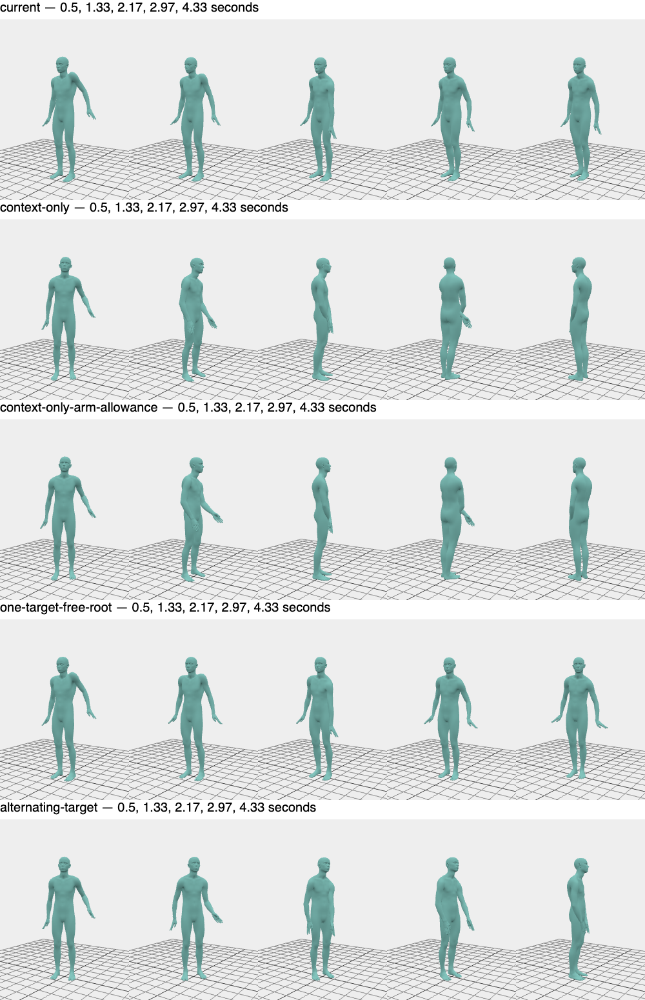

# Issue #22 continuation evidence

Refs #22. PR #23 remains **draft and incomplete**. The continuation preserves the
existing implementation and fixes pointer-trajectory estimation and seam
duration. It does not establish the user's success criterion: freely manipulating
one part while MotionBricks generates a convincing response in the other parts.

This report accompanies the continuation commit. Runtime evidence uses the
source changes in that commit; subsequent edits only add tests, experiment tools
and this evidence. The original [report](interaction-validation.md),
[measurements](interaction-validation.json) and [raw traces](interaction-traces.json.gz)
remain historical evidence, rather than being overwritten.

## Implemented fixes

- Fit linear target velocity from distinct pointer observations in the last
  100 ms. Repeated render samples do not overweight one event. Before sufficient
  history exists, retain the event estimate. A 1 ms downward jitter following an
  upward trajectory no longer reverses the prediction. Sustained reversal still
  changes its direction. Existing recency decay, 12 cm prediction cap, 2 m/s
  velocity cap and release behavior remain. This only changes conditioning;
  it never generates displayed animation directly.
- Fade small root/joint seam offsets independently over two to eight frames,
  using 1 cm / 0.06 rad offset per fade frame as the duration heuristic. Large
  offsets retain eight frames. Keyboard and specialist balance retain their
  fixed eight-frame seams. The first pose remains the displayed anchor and all
  seam offsets expire by frame eight. Diagnostics identify the adaptive seam.
  The fade heuristic is not a bound on total generated speed.

The preview-to-load anchor, held control/settings behavior, gesture revisions,
release fade and stale-result handling are preserved. There is no new mode,
reaction animation, root controller or neural joint mask.

## Fresh evidence and bounded experiments

The [summary](interaction-continuation-validation.json) and
[full compressed traces](interaction-continuation-traces.json.gz) contain fresh
real ONNX evidence, including full numeric conditioning windows and raw output.
Tests used system Headless Chrome, Apple Metal-3 WebGPU, ORT Web 1.31.1 with its
default WASM fallback, and the existing exact checkpoint cache. Its SHA-256 is
`856419dc72aeb14e591eebf4dd0ea05734a2506ddb00bcd39dd6dac2ad60f4fb`.
The cache helper verifies both bytes and digest before serving it. No fresh
remote weight download, public-origin deployment or GPU-only timing is claimed.

There are 27 isolated conditions and 21 five-second fixed-step rollouts. Each
rollout contains 150 displayed samples and 11 real generations; manipulation
lasts three seconds and is followed by two seconds of release/continuation.
Each strategy has no-drag, upward/reversed and downward/reversed trajectories.
The simulation holds its 30 Hz clock during inference to isolate conditioning;
actual browser tests separately cover latency and pointer scheduling. Warm
isolated inference was approximately 41–56 ms. No generated pose was fabricated.

The isolated experiment compares standing versus observed minimal-arm-IK
context, one versus four target frames, omitted future root features, omitted
future pose features, omitted future conditions, and ten versus six tokens.
The jitter ablation compares fitted versus latest-event velocity for identical
observations. Continuous experiments additionally test alternating whole-pose
target presence and a 0.9 rad arm correction allowance. These alternatives are
**experiments only**; the application retains its existing four-target strategy
and 0.45 rad correction bound.

These masks omit complete root or pose feature frames. The pinned upstream
[inference implementation](https://github.com/NVlabs/motionbricks/blob/54fc563aeaaf819a753d72cc9fdc6713989cdd43/tools/onnx/models/soma/inference.py)
uses separate presence masks and merges target pose frames at the final token.
The graph accepts absent future features; this does not supply an arbitrary
partial-joint trajectory constraint or guarantee quality for these inputs.

### Raw causal output versus control quality

The table compares frame-aligned **raw decoded** up/down output over all 11
generations, before seams or direct corrections to that output. Context is the
actual previous corrected playback, so this measures feedback from interaction,
not an isolated target-feature effect. Units are canonical SOMA. Removing root
translation alone can still count rigid turning as arm response; the additional
heading alignment removes that effect. Local chest rotation removes inherited
parent rotation. The no-drag and IK-only baselines are saved separately.

| Strategy | Right hand, root relative | Right hand, heading aligned | Chest local rotation | Max held-hand error, up / down |
| --- | ---: | ---: | ---: | ---: |
| Current four-target strategy | 3.95 cm | 4.38 cm | 0.044 rad | 4.85 / 5.99 cm |
| Omit future root features | 2.54 cm | 2.18 cm | 0.029 rad | 5.30 / 4.76 cm |
| Omit all future conditions | 18.67 cm | 6.64 cm | 0.028 rad | 21.68 / 20.61 cm |
| Same, 0.9 rad direct arm allowance | 12.83 cm | 5.26 cm | 0.032 rad | 13.97 / 7.61 cm |
| One target frame, omit future root | 3.67 cm | 3.45 cm | 0.033 rad | 5.63 / 5.06 cm |
| Alternate future pose presence, omit future root | 5.65 cm | 6.24 cm | 0.018 rad | 10.24 / 6.47 cm |
| Omit future pose, retain root conditions | 5.58 cm | 5.16 cm | 0.037 rad | 5.71 / 8.38 cm |

The context-only upward case accumulated approximately 179° of facing change,
with only 3.2 cm maximum root displacement. Rendered snapshots show the character
turning in place, rather than a convincing response while retaining the grabbed
point. A larger permitted arm correction did not resolve tracking. Retaining
root conditions limited facing change (upward maximum 0.158 rad) but returned to
small uncontrolled changes and weaker tracking. The larger headline differences
therefore cannot establish success. The isolated observed-context hand cases
reduced maximum raw control error from 13.5/11.1 cm to about 6.6/5.6 cm, but did
not establish strong uncontrolled motion. This is a measured tradeoff, not proof
that every possible conditioning scheme fails.



These snapshots render saved canonical displayed poses at 0.50, 1.33, 2.17,
2.97 and 4.33 seconds, including direct correction and seams. They illustrate
the accumulated turning; they are not live pointer footage or raw-only output.

### Seam and direct-correction attribution

Replaying the **same** observed-context hand-up raw segment from the same anchor
isolates stitching. Mean right-hand seam displacement falls from 0.778 cm with
the fixed fade to 0.315 cm with the adaptive fade. Maximum seam displacement is
unchanged at 3.09 cm; maximum frame step increases from 0.497 cm to 1.156 cm.
Mean wrist seam rotation remains 0.127 rad because that large offset keeps its
eight-frame fade. The change reduces duration of small corrections; it does
not reduce every peak or prove smoother/natural motion. Per-joint results for
every isolated segment and both fades are saved in `replays` in the summary.

In the actual updated SOMA hand browser window, maximum opposite-hand direct IK
displacement was below 6e-16 m and rotation below 5e-8 rad. Its maximum seam
displacement/rotation remained 2.40 cm / 0.450 rad. **Seams can still exceed the
small causal raw differences.** Pelvis correction mechanically translates
upper-body points by up to about 8 cm; it is external control, not independent
generated motion. MMD retargeting and secondary physics remain outside these
canonical raw/IK/seam measurements.

### Actual pointer regressions

Fresh real ONNX pointer tests ran on the development origin at
`http://127.0.0.1:5173/`. The production build and Pages artifact checks ran
separately. The browser suite sends sustained reversed drags, asserts the picked
joint, holds through generations, then releases/cancels. It also checks rotation,
pause, reset, preview-to-load continuity, a 700 ms genuine-result delivery delay
and rejection of an actual stale result after reset. All passed with no page
errors. Capture mode affects rendering/input timing; these are bounded recorded
windows, not frame-rate or motion-quality benchmarks.

| Character / part | Accepted during movement / after release | Max canonical control error | Max displayed root step |
| --- | ---: | ---: | ---: |
| SOMA / hand | 6 / 3 | 0.95 cm | 0.28 cm |
| SOMA / pelvis | 6 / 3 | <0.001 cm | 1.62 cm |
| Animasa / hand | 7 / 3 | 1.82 cm | 0.28 cm |
| Animasa / pelvis | 8 / 2 | 0.065 cm | 1.60 cm |
| Uka / hand | 16 / 2 | 1.46 cm | 0.80 cm |
| Uka / pelvis | 15 / 3 | 0.043 cm | 1.62 cm |

MMD physics was enabled in the recorded character cases. This establishes
pipeline/regression behavior, not acceptance of general hand/pelvis reactions.

## Review of all seven original criteria

This review applies to the continuation's runtime source, rather than treating
the old PR head's reports as current. No criterion is waived or replaced.

| Criterion | Evidence at this checkpoint | Acceptance status |
| --- | --- | --- |
| 1. Primary continuous Move/Rotate reaction | Actual pointer tests accept real segments while held and released; IK-only preview is explicit. | Partial: convincing response elsewhere remains unestablished. |
| 2. Hand and pelvis/torso demonstrations | Fresh hand/pelvis windows on all three characters; selected points follow; no authored balancing. Pelvis's mechanical translation is attributed separately. | Partial: natural independent whole-body response is not established. |
| 3. Per-joint raw/IK causality and baselines | Full inputs/raw/displayed traces, per-joint world/root-relative/heading-aligned/local differences, no-drag and IK-only baselines; distinct raw outputs. | Evidence complete for bounded cases; substantive appropriate reaction quality remains incomplete. |
| 4. Bounded correction attribution | 0.45 rad / 8 cm production limits pass; opposite hand direct correction is numerical zero; raw/seam/IK/retargeting/physics separated. | Bounds pass; cannot attribute all visible response to ONNX because seams remain significant. |
| 5. Smooth held/cancel/reversal/release/stale/latency | Real pointer suite, preview/load regression, genuine delayed/stale output, unit seams/underruns/settings checks pass. | Tested cases pass; natural settling, contact quality and large/unseen drags remain unproven. |
| 6. Three characters and existing workflows | Fresh real-model hand/pelvis tests for SOMA/Animasa/Uka; ordinary pose, specialist balance and keyboard browser regressions pass. | Integration passes; intended reaction quality across characters remains incomplete. |
| 7. Unit/browser/Pages/docs | 44 unit tests passed, one optional external-source Animasa integration skipped; all eight interaction tests passed again after strengthening the release assertion; build/Pages checks and browser suites passed. | Pre-merge executable checks pass within measured scope; full feature acceptance incomplete. Required deployment verification remains post-merge. |

The optional source-conversion skip does not skip bundled MMD asset/retargeting
checks or actual browser physics. The balance/keyboard browser checks in this
continuation are their ordinary regression suites, not new real-model recovery
or locomotion quality claims. No pending/new-head CI can be claimed before this
local commit is published. This node does not push, merge or edit PR metadata.

## Reproduction

With dependencies installed, start `npm run dev`. Use the already verified model
path as `MODEL_CACHE` and system Chrome as `CHROME_BIN` when available:

```sh
node scripts/interaction-experiment.mjs
npm run test:interaction
npx tsx scripts/summarize-interaction-experiment.ts
```

The first script has fixed bounds (27 conditions plus 21 five-second rollouts),
loads one real session and writes ignored `.artifacts/interaction-experiment/`
files. The summarizer reads those and the pointer artifacts, replays identical
raw segments through both seam variants, computes heading-aligned comparisons,
and writes the two continuation evidence files. Decompress traces with
`gzip -dc docs/interaction-continuation-traces.json.gz` to inspect full inputs,
raw outputs, control history, fixed-step displayed/IK-only trajectories and
actual browser player/displayed/correction windows.

## Decision boundary

The bounded investigation has not produced a scheme that establishes both
convincing uncontrolled motion and reliable direct tracking. The current
checkpoint provides causal influence but no native sparse temporal constraint.
Removing future pose information avoids prescribing neutral uncontrolled joints,
but the tested alternatives introduce drift/tracking tradeoffs. Increasing
deterministic authority or counting whole-body turning would not satisfy the
original criterion. No alternate experimental strategy is promoted into the UI.

The fallback is **not agreed or implemented**. Bounded options for a maintainer
decision are:

- Evaluate a constraint-aware proposal/selection controller around this exact
  checkpoint: retain joint ownership, cap the number of real proposals, and
  require raw control reach, heading/contact quality and uncontrolled causal
  response together. This is a separately scoped controller investigation with
  a WebGPU latency budget; it is not a promised solution or an accepted lowering
  of the criterion.
- Evaluate a different pretrained model only after identifying available
  weights, license, browser/runtime and retargeting requirements, and verifying
  explicit joint-trajectory conditioning with the same raw/IK baselines.
- Adapt/train explicit sparse temporal and contact conditioning: requires a
  data/license plan, training compute/budget, export/runtime plan and held-out
  continuous interaction evaluation. No training or spending is authorized here.

Keep Issue #22 open, PR #23 draft, and **Refs #22** in publication metadata.
Do not repeatedly request unchanged fixes or claim the separate approach has
already been selected. Resume dependent work after an explicit decision defining
its scope; this report does not authorize or fabricate that decision.

Required post-merge verification, if the full feature later becomes ready and
is merged: verify the merge-triggered Pages deployment against the actual merged
revision and test its public origin. This is pending future post-merge work,
not a prerequisite that can be demanded before merge. Do not close the Issue
while its required acceptance or post-merge verification remains incomplete.
