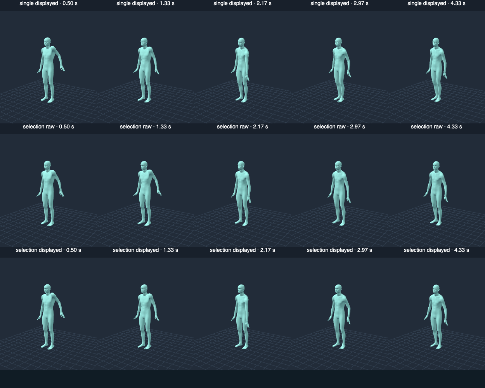

# Issue #22 bounded proposal controller

Refs #22. **The owner agreed to this controller trial using the existing
MotionBricks checkpoint. It is implemented and evaluated here.** The earlier
request to choose a controller/model/training approach is superseded. PR #23
must remain draft and Issue #22 open: these measurements do not establish a
convincing continuous hand interaction or full original acceptance.

This report describes the runtime source identified by SHA-256 in the
[review result](interaction-controller-validation.json), including the complete
seven-criterion matrix. The [full traces](interaction-controller-traces.json.gz)
retain every proposal's numeric inputs, raw decoded output and raw contact
channels, selected indices, timing, displayed/player poses, direct corrections,
no-drag and IK-only baselines. The earlier
[27-condition/21-rollout investigation](interaction-continuation-validation.md)
and its traces remain intact as historical evidence.

## Implementation and hypothesis

The new hypothesis is that selecting between complementary supported proposals
can improve tracking without promoting the large turning seen in context-only
experiments. This is a controller around the same checkpoint, not a new model,
training effort, authored reaction, native sparse-joint mask or stochastic input.

Each accepted update normally compares **two actual sequential ONNX calls**:

1. The existing four-target conditioning, editing only the selected features.
2. The same displayed history and targets with complete future pose feature
   frames absent, retaining future global/local root conditions. Interaction
   still influences observed history; this variant has no future hand channel.

Both use the supported six-token segment. The implementation configures only two
variants (below the absolute cap of three). One controller batch runs globally
within the application, one ONNX call at a time; the existing pending gate also
excludes specialist balance work. There is no job wait list or pointer backlog.
After completion the next request samples the newest displayed history. Gesture,
reset, mode/character/settings and pause revisions dispose stale work before
another proposal and after each result. Movement within a gesture coalesces
without invalidating every useful result. Rendering and immediate selected-part
feedback continue while the worker runs.

Selection uses **raw output only**, before seams, direct IK, contacts, retargeting
or secondary physics. Its cost includes the controlled point's time-aligned
forecast error, orientation error, heading change, root displacement and grounded
foot displacement. Uncontrolled local-rotation activity is a small, capped
shortfall cost: credit saturates at 0.04 rad. It excludes the direct IK chain and pelvis support legs, measures local
rotations, and cannot reward unlimited movement or rigid turning. This
activity proxy does **not** certify appropriate causal motion; paired trajectories
and no-drag evidence below are necessary and still do not establish naturalness.
The selector is a feasibility heuristic, not a physical contact solver.

Standing bounds remain, with additional trial guards of 0.65 rad heading change
and 0.25 m root displacement from the current anchor (plus explicitly imposed
pelvis displacement). A rejected batch waits at least 300 ms before retry.
These are controller guards, not replacements for original acceptance.
Raw heel/toe predictions are saved independently; geometric grounded-foot
movement affects selection but authors no animation or planted-foot correction.

A batch exceeding the initial **150 ms soft target** stops adding proposals,
reduces subsequent updates to one proposal and imposes a bounded cooldown of up
to 300 ms. Three fast single-proposal updates restore comparison. Timing includes
worker delivery, scoring and decoding; raw inference time and selection overhead
are reported separately. No queued work is created. This is local load adaptation,
not a universal hardware gate or a claim that every frame meets 150 ms.

The prior 0.45 rad / 8 cm direct correction, 350 ms release fade, adaptive seam,
preview-to-load continuity, held settings, Move/Rotate workflow and IK-only label
remain. No full-body IK target is added. Keyboard locomotion, specialist Push /
Balance, MMD assets, shading/physics and source/license pins remain intact.

## Paired real-checkpoint trial

The cache helper verified the existing 758 MB file against SHA-256
`856419dc72aeb14e591eebf4dd0ea05734a2506ddb00bcd39dd6dac2ad60f4fb`.
No remote weight download was needed. System Headless Chrome used Apple Metal-3
WebGPU, ORT Web 1.31.1 and its existing WASM fallback; timings are not GPU-only.

The bounded experiment contains twelve five-second rollouts: prior single
proposal and new selection, each with no-drag and two reversed trajectories,
first hand then pelvis. Each has 150 displayed samples, three seconds held and
two seconds released, eleven accepted generations, with no rejected batches.
The simulation holds its 30 Hz clock during inference; actual pointer tests
separately exercise live scheduling and delayed delivery. The single-proposal
hand baseline reproduces the prior 4.85/5.99 cm maximum tracking errors.

| Hand metric | Prior single proposal | Selected proposal |
| --- | ---: | ---: |
| Maximum displayed controlled-point error, up / down | 4.85 / 5.99 cm | 4.57 / 5.56 cm |
| Maximum displayed heading deviation, up / down | 0.101 / 0.132 rad | 0.045 / 0.100 rad |
| Raw right-hand up/down difference, root and heading aligned | 4.38 cm | 2.38 cm |
| Raw chest local up/down rotation difference | 0.044 rad | 0.039 rad |

The second proposal was selected in two upward and three downward hand updates.
The tracking/heading gains are modest; uncontrolled causal differences do not
become a convincing whole-body reaction. Maximum per-segment **mean raw**
controlled-hand error is still 11.62/15.02 cm for selection. Displayed tracking
therefore must not be attributed solely to generation. The raw grounded-foot
movement cost reaches 3.60 cm in the hand trials. Contact quality is not solved.

For pelvis, the alternate proposal was selected three/four times. Maximum
displayed error remains 0.49/0.29 cm with direct root control; displayed root
travel is about 10.65 cm and is explicitly imposed movement. Raw heading-aligned
opposite-hand up/down difference is 6.90 cm versus 5.66 cm for single proposal;
chest local difference is 0.026 versus 0.044 rad. Maximum segment mean grounded
foot displacement cost remains 5.89/6.82 cm. These results establish distinct
non-rigid raw output, not appropriate natural pelvis reactions.



These are rendered saved canonical poses at 0.50, 1.33, 2.17, 2.97 and 4.33 s,
not live footage or physics. The raw row omits stitching and direct correction.
The limited motion is visible; no convincing response is inferred from a
headline displacement number.

Local model load/compile took 2.37 s. The first inference took 222.8 ms (227.4 ms
batch). Warm single inference ranged from 39.6 to 62.8 ms; the median single batch was
42.1 ms including the cold sample. All selection batches in this isolated trial
used two proposals: median 83.2 ms, range 80.3–111.0 ms. Median selection overhead was 0.6 ms. There is no inference
wait queue. Full delivery/scoring timing distributions are in the JSON report.
Live MMD/rendering and diagnostics can exceed the soft target; recorded live
windows include actual counts and timing rather than extrapolating this result
across devices. Live batch medians ranged from 101 to 128 ms; Uka reached
235 ms and exercised reduced proposal counts. The delayed-delivery test accepted
two generations while moving despite a 700 ms delivery delay, then disposed one
actual stale result across reset with a 1500 ms delivery delay.

## Attribution and regressions

The live suite checks actual sustained reversed hand and pelvis pointer drags
on SOMA, Animasa Miku and Uka, generation during hold and after release, rotation,
cancel, reset, pause, preview/load continuity, delayed genuine worker output and
stale revision disposal. It verifies one or two actual candidates, selection of
the lowest valid cost, exact equality of selected raw output with the playback
segment, zero queued jobs and reduction to one proposal under delayed delivery.
MMD physics is enabled in the recorded windows. The JSON report retains their
measured control errors, root steps, raw inputs and independent IK/seam metrics.

Direct correction bounds pass. In hand windows, opposite-arm direct IK is
numerical zero. Seams can still contribute centimetres and material rotations
to that arm. Pelvis control mechanically translates upper-body positions while
foot support changes legs; this is external constraint, not generated response.
Canonical raw/correction measurements exclude MMD retargeting and secondary
physics. Enabled MMD physics and Toon/outline checks are integration evidence,
not proof of neural causality. No reaction is attributed to those extra layers.

## Original seven-criterion review

No criterion is waived. This matrix applies to the saved runtime source hashes
and this checkpoint, including corrected forecast scoring, local-DOF activity ownership and the retry bound.

| Criterion | Current evidence and remaining scope | Status |
| --- | --- | --- |
| 1. Primary continuous interaction | Actual Move/Rotate proposals during hold/release; immediate preview; convincing response elsewhere unestablished. | Partial |
| 2. Hand and pelvis/torso | Hand-first paired trials and three-character pointer windows; neither demonstrates the intended natural whole-body response. | Partial |
| 3. Raw/IK causality and baselines | Full conditioning/all proposals/no-drag/IK-only/displayed traces and per-joint heading-aligned/local metrics; appropriate substantive reaction unestablished. | Partial |
| 4. Bounded correction attribution | Bounds and unrelated-joint ownership pass; seams remain material; raw/IK/retargeting/physics distinguished. | Partial |
| 5. Smooth lifecycle and quality | Held/reversed/released/cancelled/delayed/stale cases pass; natural settling/contact quality and large/unseen drags remain unproven. | Partial |
| 6. Characters and existing workflows | Three-character real-model pointer tests, ordinary pose, keyboard and specialist balance regressions pass; intended reaction quality incomplete. | Partial |
| 7. Tests/browser/Pages/docs | 50 unit tests pass, one optional external-source conversion skip; real pointer/pose/keyboard/balance suites, build and Pages artifact checks pass locally. Full feature acceptance incomplete; deployment remains future post-merge work. | Partial |

The keyboard smoke exercises ordinary keyboard controls and the expected model
load-failure fallback, not new real-model locomotion quality. Specialist balance
uses its ordinary regression suite, not a new recovery capability claim. Local
checks do not establish unpublished-head GitHub CI or deployed-site success.

## Reproduction and publication

With dependencies installed and the dev server running, set `MODEL_CACHE` to the
existing verified weights and `CHROME_BIN` to the installed Chrome executable:

```sh
node scripts/interaction-controller-experiment.mjs
npm run test:interaction
npx tsx scripts/summarize-interaction-controller.ts
node scripts/render-interaction-controller.mjs
npm test
npm run build
npm run check:pages
```

Experiment tools load one session and write ignored artifacts; no automatic
model download is attempted. Decompress `interaction-controller-traces.json.gz`
to inspect all proposal windows and browser attribution. Unit scheduler fixtures
are deterministic synthetic tensors solely for regression tests, never reported
as model evidence. After review corrected time-aligned scoring and local-DOF activity ownership,
the paired trial and pointer suite were rerun; unchanged historical sweeps were not repeated.

Publication should describe **the implemented owner-agreed bounded controller
and its measured quality limitation**, retain **Refs #22** and keep PR #23 draft.
There is no outstanding question asking the owner to select this approach again.
This node commits local files only; remote PR metadata is left for publication.

The concrete new limitation is that comparison among these two supported
proposals improves tracking modestly but still fails to establish convincing
uncontrolled hand reaction and reliable contacts. The checkpoint has no sparse
trajectory channel, and a capped activity proxy cannot judge natural causal
appropriateness. Preserve this bounded result; do not run the same loop again or
silently increase deterministic authority. Possible separately authorized work
would need a new supported proposal/quality hypothesis or explicit sparse/contact
conditioning through another model or training. None is started or requested as
a repeat approach-selection decision here.

Only after full pre-merge scope is independently approved and current-head CI
passes may readiness/merge be considered under the workflow's authorization.
Required merge-triggered Pages deployment and public-origin checks must verify
the actual merged revision before Issue closure. They remain future post-merge
work. No push, merge, deployment, confirmation-helper change or approval result
is claimed in this checkpoint.
