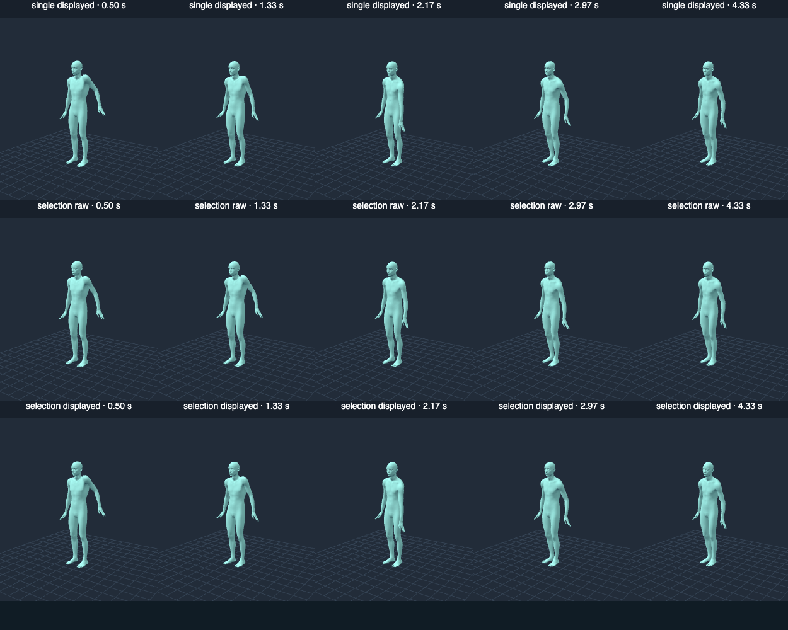

# Issue #22 bounded proposal controller

Refs #22. The owner agreed to the bounded proposal/selection trial using the
existing MotionBricks checkpoint. **The trajectory-grounded comparison is now
implemented and evaluated, but full Issue #22 acceptance remains unmet.** Keep
PR #23 draft and the Issue open. No repeat approach-selection question is pending.

This review applies to the ten runtime source SHA-256 hashes in the
[current saved review result](interaction-residual-validation.json).
It retains the complete seven-criterion matrix; no acceptance field or human
confirmation result is sent to a confirmation helper. The
[recorded full traces](interaction-response-quality-traces.json.gz) contain all
actual proposals, numeric conditioning, raw decoded poses/contact predictions,
selected indices, displayed/player poses, direct corrections and timing. The
[original capture summary](interaction-response-quality-validation.json) retains
its original scores and source hashes for audit. The current result rescores
those immutable actual proposals: nine captured runtime files are unchanged;
only the scorer differs. All 201 selections remain unchanged. This is offline
recomputation, not a fresh browser/inference or timing measurement. The
[earlier controller result](interaction-controller-validation.json),
[earlier full controller traces](interaction-controller-traces.json.gz), and
[27-condition/21-rollout investigation](interaction-continuation-validation.md)
remain historical evidence. The former controller's activity reward is superseded.

## Corrected absolute-residual comparison

The review found that capped unrelated local rotation could improve selection
without helping the imposed interaction. That reward has been removed entirely.
The new hypothesis tests **trajectory residual reduction against a matched actual
no-control proposal**, rather than motion magnitude.

A subsequent review found that the assistance calculation still used the
target-minus-history-anchor displacement after the matched baseline had already
moved. That could reward overshoot. Position assistance now subtracts reconstructed
distance from baseline distance to the **same absolute trajectory point**.
Orientation compares both quaternions to the **same absolute trajectory rotation**,
without applying the requested delta to the moving baseline again. For pelvis,
both trunk poses receive the same remaining translation from baseline root to
imposed root and are compared against the same anchor chest/head positions.
Existing root/direct-chain ownership exclusions and credit caps are unchanged.

In the saved LeftHand/selection/down window at 2333.333 ms, the old score granted
0.171 mm credit even though model-owned substitution worsened mean tracking by
0.150 mm. Corrected credit is zero. The saved result retains old and new scores
for every proposal, plus an explicit regression for that actual window.

Each normal update makes two sequential actual ONNX calls with the same displayed
history, neutral future pose frames, six-token budget and full-frame presence
masks. The first edits the selected part's future features with the existing
bounded trajectory prediction. The second leaves those future frames neutral,
removing the imposed future control features. The second is a matched
counterfactual for the *future conditioning*, not a history without manipulation:
both histories include the same previous externally corrected playback. Complete
no-drag rollouts separately expose ongoing unconditioned motion. No unsupported
joint masks, fabricated randomness or alternate model is used.

Both proposals are selectable and are scored against the **same imposed
trajectory**. Raw controlled position/orientation error, heading, root travel and
geometric grounded-foot drift remain the primary costs. To isolate potential
uncontrolled assistance, scoring reconstructs a diagnostic pose using the
baseline's root and direct-chain local rotations and the candidate's other local
rotations. For a hand/foot/head/chest, credit measures reduction in the imposed
position/orientation residual caused by those model-owned DOFs. For pelvis
translation it measures whether model-owned trunk articulation reduces imposed
world translation of the chest/head. The latter is a conservative trunk-stability
hypothesis, not a claim that stationary landmarks are always a natural reaction.

The diagnostic reconstruction never reaches playback, conditioning, contact
correction or retargeting. It is not a pose solver. Root movement and whole-body
turning earn no response credit; unrelated opposite-arm activity cannot improve
hand reach or pelvis trunk stability. Motion common to the matched baseline earns
no credit. Motion that worsens the remaining residual and changes confined to the
direct IK chain earn none. Per-frame positional improvement
is capped at 4 cm; orientation contributes at most 1 cm equivalent, and final
credit is capped at 4 cm equivalent with weight 0.5. Negative improvements offset
positive ones before the final clamp. This bounds the incentive and relates it
to input and matched output, but does not certify naturalness or reward every
possible useful counterbalance.

A missing/rejected counterfactual grants zero credit. The cold/slow path still
uses one actual proposal, never a fabricated baseline. The unchanged resource
contract is normally two proposals, configured maximum two (below the absolute
cap of three), one ONNX call in flight globally, no work queue, coalesced current
history, stale-revision disposal, bounded feedback and worker inference. The
150 ms initial soft target reduces candidate count and update frequency under
load; three fast updates restore comparison. Heading/root guards, 300 ms maximum
cooldown, selected-part correction limits, release fade and adaptive seams remain.

## Recorded real-checkpoint evaluation and current rescore

The helper verified the existing 757,864,273-byte cache against SHA-256
`856419dc72aeb14e591eebf4dd0ea05734a2506ddb00bcd39dd6dac2ad60f4fb`.
No weights were downloaded. System Headless Chrome used Apple Metal-3 WebGPU,
ORT Web 1.31.1 and its existing WASM fallback; timings are not GPU-only.

Twelve five-second rollouts compare prior single-proposal and changed selection
under identical no-drag/upward-reversed/downward-reversed inputs, first hand then
pelvis. Each records 150 fixed-step samples, three seconds held and two released,
eleven generations, IK-only output and every candidate. There are 132 generation
windows and 198 actual proposals, with no rejected batches. This evaluates the
changed comparison; the old mask/velocity/quality sweep was not repeated. The
fixed-step clock pauses during inference; live pointer tests cover scheduling.

| Metric, up / down | Single proposal | Matched selection |
| --- | ---: | ---: |
| Hand maximum displayed error | 4.85 / 5.99 cm | 4.85 / 5.99 cm |
| Hand maximum segment-mean raw error | 12.47 / 16.11 cm | 12.47 / 16.11 cm |
| Hand maximum displayed heading change | 0.101 / 0.132 rad | 0.101 / 0.133 rad |
| Pelvis maximum displayed error | 0.49 / 0.29 cm | 0.76 / 1.50 cm |
| Pelvis maximum displayed heading change | 0.151 / 0.232 rad | 0.140 / 0.060 rad |
| Pelvis maximum segment-mean grounded-foot drift | 6.36 / 7.03 cm | 3.60 / 3.60 cm |

The neutral proposal was selected zero/one times for hand and five/five times for
pelvis. Offline rescoring changes none of these selections or the displayed/raw
trajectory metrics above. Corrected hand reach-assistance credit peaks at
**1.27/1.39 mm**, with positive credit in seven/six of eleven updates. Corrected
pelvis trunk-assistance credit peaks at 1.16 mm upward and is numerical zero
downward. These small values expose the
lack of substantial trajectory-helpful uncontrolled generation instead of
rewarding unrelated activity. The new controller does not improve hand tracking.
Pelvis heading/contact costs improve, with worse tracking and continuing direct
root dependence. No natural reaction is inferred from those tradeoffs.

Raw heading-aligned right-hand up/down differences are 4.37 cm for selected hand
trials versus 4.38 cm single, and 4.72 cm for selected pelvis versus 5.66 cm single.
Chest local differences are 0.044 rad for hand and 0.029 rad for pelvis. These
continuous differences include history feedback, rather than isolating current
future features. The JSON additionally saves per-joint differences from each
same-history counterfactual, and the traces permit complete recomputation.
Distinct raw output is measurable; substantive appropriate reaction remains
unestablished.



Snapshots show saved canonical poses at 0.50, 1.33, 2.17, 2.97 and 4.33 seconds.
The raw row excludes seams and direct correction. These are not live footage,
MMD physics or proof of a convincing interaction. The limited motion remains
visible.

### Recorded actual resource timing

Local load/compile delivery took 2.41 s (worker load report 2.19 s). First cold
inference took 215.3 ms, with a 219.9 ms batch. Subsequent actual inference ranged
from 38.9 to 67.4 ms. Single-batch median was 42.0 ms including the cold sample.
All isolated comparison batches used two proposals: median **83.8 ms**, range
79.7–112.1 ms; median selection/decoding overhead 0.8 ms, maximum 1.2 ms.
There were zero queued jobs. These measurements meet the initial soft target on
this local isolated setup, without establishing a cross-device gate.

Live three-character batch medians ranged from 75.2 to 122.0 ms, maxima reached
207.5 ms and candidate counts reduced under load. The genuine 700 ms delayed
worker-delivery regression accepted three generations during movement; a genuine
result delayed by 1500 ms was disposed across reset. No synthetic inference or
queue timing is reported as a measurement.

## Pointer, attribution and regression evidence

The original real-pointer suite passed on the development origin
`http://127.0.0.1:5173/`, including primary Move/Rotate, hold, reversal, release,
rotation, pointer cancel, reset, pause, preview-to-load continuity, genuine delayed
results and stale revision disposal. It checks actual proposal counts, zero queue,
lowest valid raw cost and equality of selected raw poses with the playback
segment. MMD physics was enabled in both MMD cases.

| Character / part | Generations during movement / after release | Maximum canonical control error |
| --- | ---: | ---: |
| SOMA / hand | 6 / 2 | 1.03 cm |
| SOMA / pelvis | 6 / 3 | 2.17 cm |
| Animasa / hand | 7 / 3 | 2.56 cm |
| Animasa / pelvis | 7 / 3 | 0.065 cm |
| Uka / hand | 14 / 3 | 1.39 cm |
| Uka / pelvis | 14 / 3 | 0.043 cm |

The saved-trace checker independently recomputed supported input features and
scores for **201 windows / 318 proposals**, checked all ten current runtime source
hashes (nine capture-matched files plus the corrected scorer), and verified
correction bounds over **1,784 recorded browser samples**. No ranking changes
were found, so browser inference and the heavy motion experiments were not
repeated for this arithmetic fix. Original timing and trajectory measurements
retain their provenance. Feature
comparison allows 1e-6 for browser/Node Float32/trigonometric rounding; masks and
token constraints remain exact. Tests also demonstrate no reward for unrelated
opposite-arm activity at multiple amplitudes, shared baseline activity, wrong
trajectory direction, root travel or direct-chain motion, and positive credit for
model-owned reach help/trunk stabilization. New regressions cover moving and
overshooting baselines for position and rotation, including time-varying motion,
and already counterrotated/translated pelvis baselines. Scheduler cancellation, exclusion,
slow-path recovery, invalid-baseline behavior and rejection backoff remain covered.

The 0.45 rad correction bound passed. Hand direct IK changed the opposite hand by
less than 6e-16 m / 4.3e-8 rad. In SOMA's hand window, opposite-hand seam displacement
still reached **2.44 cm / 0.452 rad**, exceeding the small matched reach-assistance
credit (different metrics; they are not additive causes). Pelvis correction moved
upper-body points by up to 8 cm mechanically. Neither can be attributed to
independent neural reaction. Raw generation, direct IK and seam evidence remain
separate; canonical measurements exclude retargeting and secondary MMD physics.
Physics/shading checks establish integration, not neural causality.

## All seven original criteria at current runtime source

No criterion is waived. The complete matrix is also retained in the saved review
result. Historical CI or prior motion-quality reports do not establish current
feature acceptance.

| Criterion | Current evidence and limitation | Status |
| --- | --- | --- |
| 1. Primary continuous response | Actual Move/Rotate generations during movement and release, responsive preview; convincing response elsewhere remains unestablished. | Partial |
| 2. Hand and pelvis/torso quality | Hand-first trial plus pelvis and three-character windows; neither demonstrates natural whole-body response; pelvis depends on direct root control. | Partial |
| 3. Raw causality and baselines | Full inputs/all actual proposals/raw/displayed/IK-only/no-drag traces retained; corrected absolute-residual scoring rescored 201 windows/318 proposals with no ranking changes. Substantive appropriate reaction remains unestablished. | Partial |
| 4. Bounded corrections and attribution | Correction/ownership bounds pass; seams remain material and pelvis mechanically translates upper body. Natural response cannot yet be attributed to generation. | Partial |
| 5. Smooth lifecycle and motion quality | Held/reversed/released/cancelled/delayed/stale/preview-load tests pass with bounded work; natural settling and reliable contacts remain unestablished. | Partial |
| 6. Three characters and regressions | Recorded SOMA/Animasa/Uka hand/pelvis ONNX windows with MMD physics; intended quality remains unestablished. Recorded ordinary pose, system-Chrome keyboard/MMD and specialist balance regressions pass. | Partial |
| 7. Tests, browser, Pages, docs | 56 unit tests pass, one optional external-source Animasa conversion skipped; current build, Pages artifact and offline rescore checks pass. Recorded browser evidence is retained; no new inference/timing claimed. Full feature acceptance incomplete; merged Pages/public-origin verification remains future post-merge work. | Partial |

For this scoring revision, 56 unit tests passed with one optional external-source
Animasa conversion skip; the focused controller suite passed all twelve cases.
The saved-trace rescore/check, build and Pages artifact check passed. The following
browser results are retained from the original capture, not rerun here:
ordinary pose and specialist Balance browser suites passed. The ordinary keyboard/MMD suite first
failed its physics screenshot comparison under bundled Playwright Chromium
(0 changed pixels). The same suite passed using system Chrome, matching the
browser used for actual ONNX trials; no application or assertion was changed to
obtain that pass. Its keyboard check includes the expected model-host failure
fallback, not a new real-model locomotion-quality claim.

Build passed (existing large-chunk advisory). Pages artifact check passed: 27 files,
44.1 MB, reviewed assets only. The optional source-conversion skip does not skip
bundled MMD assets, retargeting or browser physics. Current local results do not
claim GitHub CI success, deployment, human acceptance or approval.

## Reproduction and publication

With dependencies installed, reproduce the current offline correction without
inference or a model download using:

```sh
npx tsx scripts/check-interaction-response-quality.ts --write
npx tsx scripts/check-interaction-response-quality.ts
npm test
npm run build
npm run check:pages
```

The first command writes `interaction-residual-validation.json`; the second
verifies it against all original features, proposals and current source hashes.
Both validate the actual review regression, ownership bounds and ranking impact.
The seven-criterion matrix remains in that saved review result. Historical
controller/continuation evidence and the original capture summary/compressed
traces are preserved unchanged. The original capture used
`interaction-controller-experiment.mjs`, `test:interaction` and
`summarize-interaction-controller.ts` at the captured source hashes, followed by
`render-interaction-controller.mjs` for snapshots. Do not overwrite that review
fixture with a new capture. Deterministic unit tensors are regression fixtures
only, never real-model evidence. No unchanged heavy suite needs a repeat merely
to publish these files.

The concrete limitation of this bounded current-controller experiment is **very
small trajectory-helpful uncontrolled output, continuing seam/IK dominance and
unreliable natural contact/settling quality**. It does not establish the original
user intent. Preserve this result; do not rerun the same hypothesis or increase
IK authority to claim success. A future separately authorized investigation could
change supported conditioning with a demonstrably different response hypothesis,
or investigate explicit sparse/contact conditioning through another model or
training. None is started here; the owner-agreed controller decision remains in
force and is not being asked again.

Publication must retain **Refs #22**, describe the changed implementation and
measured limitation, and keep PR #23 draft. No push, merge or PR metadata mutation
is performed by this node. Readiness/merge requires full pre-merge scope to be
independently approved and current-head CI passing. Required merge-triggered Pages
deployment/public-origin checks must verify the actual merged revision; those
remain future post-merge work. The current
[merge and follow-up lifecycle](development-flow.md#merge-and-follow-up) supersedes
the former instruction to perform them before Issue closure. Once implementation
and mandatory pre-merge acceptance are complete, merge and close, then verify.
This does not change the measured limitations or historical evidence above.
