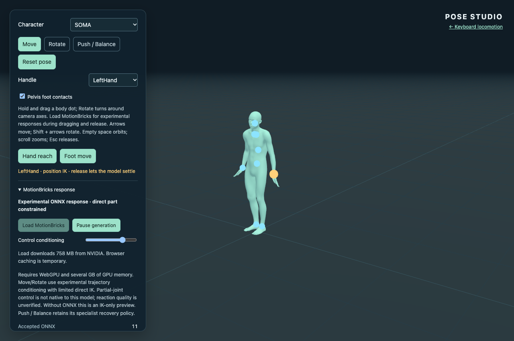
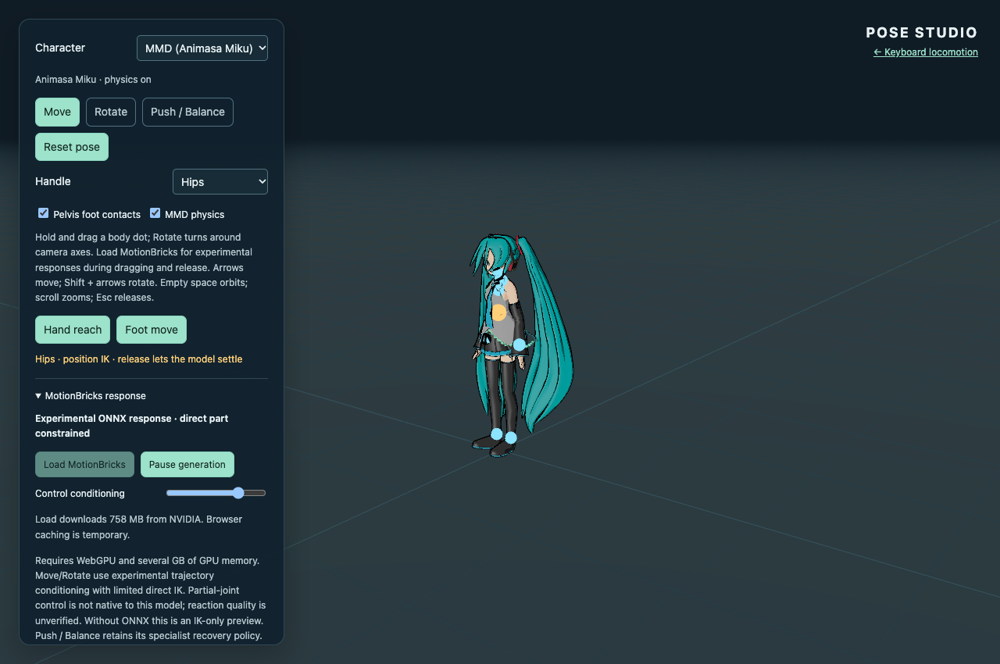

# Continuous direct interaction feasibility — Issue #22

The [continuation report](interaction-continuation-validation.md) records the
current trajectory/seam fixes, fresh real ONNX evidence, bounded continuous
conditioning experiments and all seven acceptance criteria. The measurements
below are preserved historical evidence from the initial implementation; they
must not be presented as measurements of the updated source.

This implementation makes Move/Rotate the primary interaction and runs real
MotionBricks during dragging and release. **Issue #22 should remain open.** The
measurements establish a working experimental pipeline and causal conditioning
influence, but do not establish the requested natural, general whole-body
reaction quality. In particular, hand-driven uncontrolled motion is modest,
neutral pose conditioning still constrains every unselected joint, and seam
blending can exceed the small raw hand-induced differences. No authored balance
reaction, stock settling pose or synthetic ONNX output substitutes for this gap.

The older [pose-editor validation](pose-validation.md) and
[specialist balance validation](balance-followup-validation.md) describe their
historical implementations; they are not acceptance evidence for this requirement.

## Ownership and runtime behavior

- A control records the selected joint, canonical world position/orientation,
  velocity, angular velocity, held/released state and four control samples at
  30 Hz. MMD cursor displacement is converted through the existing retargeting
  scale and visible-handle feedback. Recent **displayed** poses, rather than
  authored future IK poses, supply the four model context frames.
- Position correction owns only the nearest chain: shoulder/upper arm/forearm
  for a hand, hip/knee for a foot, neck for head, and upper spine for chest.
  Rotating a branch carries descendants to retain their local skin transforms.
  The opposite arm, legs, root and torso have zero direct correction during a
  hand interaction. Their motion comes from decoded output and the disclosed
  seam blend. This does not promise that they will move substantially.
- A pelvis grab is **external root control**. It is limited to 25 cm from the
  grab origin; pelvis rotation is limited to 0.4 rad. Root translation carries
  upper-body points mechanically. Optional **Pelvis foot contacts** allows only
  leg-chain compensation toward captured foot positions. Neither translation
  nor contact compensation is evidence of an independently generated reaction.
- Corrections to generated playback are bounded to 0.45 rad per joint and 8 cm
  at the root relative to the current player sample. They can sacrifice tracking
  when a request is infeasible. There is no global full-body target solver in
  this path, and no scripted weight shift, counterbalance or step.
- One inference runs at a time. Pointer changes coalesce without changing the
  gesture revision; release also accepts an in-flight segment. A new grab,
  reset, mode/character switch, pause or visibility interruption invalidates old
  work. Accepted output is blended from the actually displayed pose, with the
  per-component two-to-eight-frame seam fade (eight frames for large offsets).
  Underruns hold the last model frame while the
  selected part stays responsive. Release fades direct correction over 350 ms,
  then removes the control and requests neutral continuation of the current
  pose, without forcing a standing stock pose.
- Without loaded/running ONNX, this remains explicitly an **IK-only preview**;
  releasing holds the preview. Empty-space orbit, pointer capture, Escape,
  pointer cancellation and blur retain their established ownership behavior.
  Animasa's chest handle is placed above its pelvis-level torso pivot so the two
  parts can be selected separately. MMD driving joints remain authoritative over
  secondary physics; Toon, outline and secondary physics are unchanged.

## Actual conditioning contract

The pinned model and SHA-256 remain in [model-source.json](../model-source.json).
The encoder's float inputs are `[1,8,5]` global root, `[1,8,4]` local root and
`[1,8,267]` pose values. The three presence masks are integer tensors `[1,8]`.
Their entries select **whole frames/features**, not joints, coordinates or
fractional control weights. The first four frames supply context; the last four
supply target conditions. The upstream
[SOMA export wrapper](https://github.com/NVlabs/motionbricks/blob/54fc563aeaaf819a753d72cc9fdc6713989cdd43/tools/onnx/models/soma/model.py),
[inference implementation](https://github.com/NVlabs/motionbricks/blob/54fc563aeaaf819a753d72cc9fdc6713989cdd43/tools/onnx/models/soma/inference.py)
and [target parameters](https://github.com/NVlabs/motionbricks/blob/54fc563aeaaf819a753d72cc9fdc6713989cdd43/motionbricks/runtime/target_pose.py)
confirm frame conditioning and the supported one-to-four target-frame count.
Upstream hand/foot IK pin masks belong to the deterministic corrector; they are
not native neural partial-joint masks.

`encodeInteraction` copies the latest plausible pose into the four neutral target
frames, then edits only the selected joint's position and/or rotation features.
For pelvis position, root features change and other joint position features are
adjusted to retain their neutral **world** positions, instead of specifying a
rigidly translated full-body target. Root velocities are recomputed from these
positions using the upstream 30 Hz convention. Future chain rotations are never
solved with IK for conditioning.

Targets predict 0.5–0.6 seconds ahead, matching the end of the shortest supported
six-token/18-frame segment. Linear prediction is capped at 12 cm and 2 m/s;
the continuation fits velocity from distinct observations over the last 100 ms
instead of relying only on the latest pointer event. The original event
estimate remains the fallback until enough observations are available.
Angular velocity is capped at 3 rad/s. Velocity influence decays with 150 ms
recency. The conditioning slider blends selected features against their neutral
values; it does not change mask semantics or correction authority. The default
uses four target frames. The A/B test also exercises one target frame and an
earlier 0.033-second horizon. All other whole-pose features remain present and
neutral, which can suppress reactions. The sparse position/orientation edits may
also be outside the model's trained full-pose distribution. These are explicit
limitations, not a claim of native partial-joint conditioning.

## Real ONNX A/B measurements

Validation on 2026-11-06 used system Headless Chrome 157 on macOS, Apple Metal-3,
ORT Web 1.31.1, the pinned FP32 checkpoint and WebGPU with ORT's default WASM
fallback. The ten isolated conditions share the same standing context and the
same allowed six-token duration. This isolates changes to target features from
changes to already corrected context. Repeating no-drag produces identical
positions, with quaternion angle roundoff below 2e-8 rad. Warm inference was
about 37–41 ms; the first inference was about 205 ms. These are browser wall
measurements, not GPU-only timings.

The table reports **mean frame-aligned raw output differences** before IK,
seams, retargeting and MMD physics. Root-relative distance removes imposed root
translation. Full measurements for all 30 joints are in
[the validation report](interaction-validation.json), with full inputs/raw/displayed
traces in [the compressed evidence](interaction-traces.json.gz).

| A/B comparison | Uncontrolled right hand, world | Right hand, root relative | Right hand rotation | Chest rotation |
| --- | ---: | ---: | ---: | ---: |
| Hand up vs no drag | 1.60 cm | 1.58 cm | 0.052 rad | 0.012 rad |
| Same hand endpoint, reversed velocity | 1.63 cm | 1.60 cm | 0.052 rad | 0.011 rad |
| Hand up vs hand down | 1.76 cm | 1.71 cm | 0.057 rad | 0.028 rad |
| Sparse hand vs static full-body IK target | 5.05 cm | 4.88 cm | 0.146 rad | 0.161 rad |
| Four vs one target frames | 1.73 cm | 1.83 cm | 0.102 rad | 0.018 rad |
| Pelvis left vs pelvis right | 15.88 cm | 12.01 cm | 0.283 rad | 0.244 rad |

The hand-up raw endpoint root travel is only 3.9 mm; uncontrolled hand travel
within that segment is about 1.2 cm. Pelvis-left/right root travel is about
16.5/13.7 cm, with substantial root-relative arm changes. These differences are
real model output. They are not proof of physical balance, appropriate intent,
contact quality or natural-looking reactions. A larger response from the static
IK-completed comparator cannot establish independent generative control: that
comparator authors shoulder and torso goals too.

Raw hand tracking is weak: maximum raw controlled-hand error is approximately
13.5 cm for hand-up and 11.1 cm for hand-down. Direct IK is necessary for visible
cursor following. The IK-only baseline and per-frame direct corrections are
recorded separately; hand IK has effectively zero effect on the opposite arm,
torso, legs or root. Pelvis corrections include the imposed root translation
and explicitly permitted leg compensation.

## Browser interaction and correction evidence

The browser suite actually clicks the requested hand/pelvis handle, asserts joint
identity, sends a sustained changing/reversed mouse trajectory, holds through
multiple real generations, then releases or cancels. It repeats on SOMA,
Animasa Miku and Uka with MMD physics enabled. It also covers rotation, pause,
reset, stale results and a test-only 700 ms delay of actual ONNX results. Reports
separate actual model timing from that injected scheduling delay. No model
output is fabricated. See the report for the measured generation counts, control
errors and per-joint direct/seam correction maxima.

The final pointer run used the production build at
`http://127.0.0.1:4173/three-motionbricks/`, with a SHA-256-verified streaming local
cache supplying only the model request. App, worker and WASM assets came from the
production preview. This tests the prefixed build and inference path; it does not
verify the public deployment or a fresh remote weight download.

| Character / held part | Accepted while moving | Accepted after release | Maximum canonical control error | Maximum displayed root step |
| --- | ---: | ---: | ---: | ---: |
| SOMA / hand | 6 | 3 | 1.069 cm | 0.17 cm |
| SOMA / pelvis | 6 | 3 | 0.011 cm | 1.62 cm |
| Animasa / hand | 7 | 4 | 2.566 cm | 0.16 cm |
| Animasa / pelvis | 8 | 3 | 0.065 cm | 1.60 cm |
| Uka / hand | 16 | 3 | 1.404 cm | 0.47 cm |
| Uka / pelvis | 16 | 2 | 0.043 cm | 1.62 cm |

These are the recorded bounded windows in capture mode, not frame-rate or motion
quality benchmarks. The injected-delay case accepted three generations during
movement. A separate 1,500 ms held result was deliberately delivered after reset
and discarded (one actual old-revision result), rather than relying on an empty
post-reset trace to test cancellation.

The hand correction bound reaches 0.45 rad in some samples. At an uncontrolled
right hand, direct IK displacement is below 1e-15 m and rotation below 6e-8 rad
(numerical roundoff). The existing seam layer can change the right hand by about
2.8 cm / 0.45 rad in the initial SOMA transitions; this can exceed the
small raw hand-conditioned differences. **Displayed movement cannot all be
credited to raw ONNX reaction.** During pelvis manipulation, upper-body
translations caused by the direct root correction are likewise not credited as
independent reactions. The saved player samples allow the seam layer to be
compared against frame-aligned raw output independently of direct IK.





## Reproduction and check scope

Start `npm run dev` after `npm ci` and `npm run assets:model`. Set `CHROME_BIN` if
needed. The conditioning/summary tools import development modules and therefore
require the development origin. The pointer suite also supports a built preview
through `DEMO_URL`; production uses the pinned remote model URL.

```sh
npm test
npm run build
npm run check:pages
npm run test:pose
npm run test:balance
npm run test:browser
npm run test:interaction
npm run test:interaction:conditioning
npx tsx scripts/summarize-interaction.ts
```

`test:pose -- --model` runs the continuous-interaction model suite. New fast tests
cover chain ownership, feature isolation/frame masks, trajectory velocity,
30 Hz history, seam continuity, release fade, new-grab/reset cancellation and
underrun holding. The ordinary pose suite retains keyboard, feet, rotation,
cancel, camera, character-switch, failure, no-WebGPU and narrow-layout checks.
The specialist balance smoke explicitly enters Push mode. Balance policy and
keyboard locomotion implementations are unchanged. The optional exact-source
Animasa conversion integration test is skipped without its external source;
bundled Animasa retargeting and real browser physics are exercised.

`?captureMotion=1` saves up to 12 recent complete input/output sequences and 360
recent displayed frames. Each sequence contains full numeric input tensors,
context/neutral targets, trajectory state and raw decoded poses. Each displayed
sample records model generation/frame, player and displayed pose, direct
correction, canonical control error and held state. Data are canonical SOMA;
retargeting and secondary physics are reported separately. Capture mode serializes
large diagnostics and affects rendering/input timing. It is not a performance
benchmark. The compressed artifact contains the complete recorded windows, not
an unbounded session history; decompress it with `gzip -dc` to inspect its JSON.

Mandatory unit checks passed (40 passed, one external-source integration test
skipped), along with build, Pages artifact checks and local browser smoke suites; the
JSON report records the real-model measurements. Publication was not performed: deployment and public-origin
verification remain unperformed because this node must not push or publish.

## Remaining acceptance and next step

The primary flow, continuous scheduling, ownership boundary, canonical/MMD
integration and causal evidence are implemented. This does **not** close Issue
#22's natural-interaction quality requirement. Hand responses remain subtle;
feet are not guaranteed to maintain contact, large/unseen controls are unproven,
and a neutral full-body target still imposes unselected-joint information.
The checkpoint has no native sparse joint-trajectory input. These experiments
neither prove that all possible conditioning schemes fail nor justify labeling
the current reactions as general physical behavior.

The continuation also tested supported feature/frame masking and continuous
feedback before reassessing the fallback. See its measured tradeoffs and bounded
options in the [continuation report](interaction-continuation-validation.md#decision-boundary).
The owner subsequently agreed to the bounded proposal/selection controller using
the existing checkpoint. Its implementation and fresh evidence are recorded in the
[current controller report](interaction-controller-validation.md). No different
model, training run or hand-authored reaction policy is substituted.
