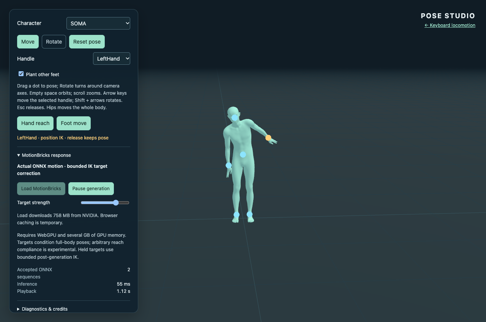
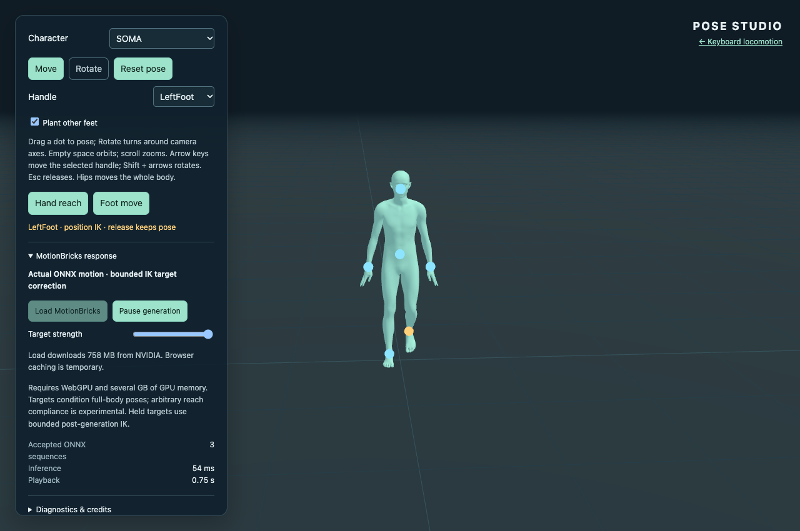

# Interactive pose demo (Issue #17)

`pose.html` is a second Vite entry point. The existing `index.html` remains the
keyboard locomotion demo. Both use the same stage, SOMA loader, MMD loader,
retargeter, inference worker, model URL and resource disposal. No character assets,
licenses, weights or worker tensor contracts were changed.

## Interaction and pose space

The six pickable handles are SOMA Hips, Head, both Hands and both Feet. MMD
handles are placed on the corresponding **visible retargeted bones**, not on
invisible SOMA geometry. Four retarget feedback iterations compensate for limb
proportion differences when converting a visible drag into a canonical goal.
Extra MMD bones never enter the 30-joint conditioning pose.

Move projects the pointer onto a camera-facing plane through the grabbed joint,
retaining the initial grab offset. Rotate uses horizontal/vertical pointer
displacements around camera up/right. Pointer capture, Esc, cancel, blur and
lost capture release OrbitControls ownership. Camera damping does not advance
during an active grab. The handle menu and arrows/Shift + arrows provide keyboard
position/orientation control after leaving form focus.

The solver performs 24 constrained CCD passes over the connected parent chain.
World rotations propagate through descendants, retaining local offsets and bone
lengths. Limits are relative to the relaxed native stance: signed elbows
[-2.7, 0] radians, knees [0, 2.65], with separate torso, shoulder, hip, wrist and
ankle cones. Foot drags shift the pelvis by up to 0.25 m and keep it inside the
opposite planted leg's reach sphere before solving. Other-foot support is optional;
Hips movement deliberately translates the entire body. Foot goals have a floor
of 0.04 m. Unreachable goals saturate instead of stretching bones. Reset restores
the stationary stance; switching models clears selection, constraints and stale
requests and disposes previous physics/resources.

MMD previews used by the feedback solver only retarget the skeleton. The final
frame applies retargeting/IK, then advances the existing secondary simulation
once. Mapped driving-bone transforms are restored after the MMD solver so it
cannot override controlled limbs; hair, skirt, necktie and auxiliary bones still
simulate. Toon/outline paths are unchanged.

## Conditioning and playback

The history samples displayed full-body poses at 30 Hz. An edit retains the four
latest observed samples for its coalesced request, so a debounce/inference delay
does not replace the approach trajectory with four copies of the held goal.
After acceptance, subsequent requests use recent displayed history again. Each request encodes four
history frames and four full-body targets interpolated toward the latest feasible
IK pose at `strength × [0.7, 0.8, 0.9, 1.0]`. The existing `encode()` produces all
seven SOMA features. These goals are conditioning, never an animation clip played
as if it were generated. The Hand reach and Foot move buttons author IK examples
through the same manipulation path as pointer input.

Requests are single-flight and coalesce edits for 180 ms. Each pose edit, reset,
pause or model switch invalidates older requests. A fresh result hands off from
the currently displayed pose through `MotionPlayer`'s eight-frame seam correction;
an underrun holds the last pose. No worker restart occurs on pointer movement.
The retained effector/orientation is solved after generation, with at most 1.0
radians of angular and 0.08 m of root correction relative to each generated frame.
This retains model motion but cannot guarantee exact contact for poor predictions.
Collapsed standing poses or excessive per-frame root travel pause generation with
a reason and leave IK usable. Missing WebGPU/download/runtime failures also retain
useful manipulation and display an explicit IK-only status with retry.

Diagnostics distinguish immediate IK from accepted ONNX sequences and expose
generation/discard counts, latency, target error, raw decoded endpoints, actual
target/context endpoints and bounded displayed traces. `?captureMotion=1` includes
the latest complete raw decoded sequence. Save motion report exports this evidence.

## Validation and limits

The fast tests cover connected-chain convergence, planted support, fixed lengths,
unreachable and non-finite goals, signed hinge/cone limits, rotation propagation,
four-frame conditioning shapes/finiteness, generation transitions/cancellation,
poor-response rejection and both MMD handle mappings/pose authority. The new
browser suite adds real pointer drags, Rotate/Esc ownership, release retention,
hips translation, reset, mobile visibility, physics allocation cleanup, overlapping
loads, page navigation, missing weights and WebGPU fallback. These browser
boundaries are separate from the fast math tests; normal CI does not download
weights or require a GPU.

Measured results and captures are recorded in [pose-validation.json](pose-validation.json).
The production-prefix preview passed in Chrome 157 on Apple/Metal WebGPU with
ORT Web 1.31.1. Fast tests: 23 passed, one pre-existing optional `ANIMASA_SOURCE`
conversion test skipped. Build and the 44 MB Pages artifact check passed. Both
pose browser modes passed, as did the existing locomotion browser modes, including
real walk/run/turn/stop (13 accepted sequences; maximum displayed root step 8.1 cm).

| Actual ONNX example | Strength | Decoded frames | Inference | Raw canonical target error at endpoint | Sampled displayed visible-target error |
| --- | --- | --- | --- | --- | --- |
| SOMA hand reach | 0.8 | 38 | 55 ms | 10.6 cm | <0.1 mm |
| SOMA foot move | 1.0 | 26 | 54 ms | 11.7 cm | <0.1 mm |
| SOMA softer hand reach | 0.4 | 42 | 56 ms | 5.3 cm | <0.1 mm |
| Animasa hand reach | 0.8 | 34 | 52 ms | 13.5 cm | 2.3 mm |
| Uka hand reach | 0.8 | 22 | 51 ms | 12.1 cm | 0.23 mm |
| Uka live held-pointer response | 0.8 | 18 | 50 ms | 1.6 cm | <0.1 mm |

Raw errors compare canonical decoded endpoints with canonical conditioning
endpoints. Displayed errors compare the post-IK **visible** joint with the requested
visible target, sampled during playback; they are not sequence-wide maxima.
Generated hand-reach joint travel was up to 29.6 cm, versus 14.4 cm at strength
0.4 in these trials. That shows distinct actual full-body responses, not a
guaranteed monotonic strength relationship. The retained approach history avoids
the earlier nearly static conditioning. A 0.4-radian correction trial allowed a
17.1 cm hand miss; raw-sequence analysis needed up to 0.8624 radians. The final
1-radian cap passes the demonstrated held-target checks while preserving unrelated
generated motion. Full experiment details remain in the JSON record.





Full raw captures are produced in ignored `.artifacts/pose/` by:

```sh
npm test
npm run build
npm run check:pages
npm run preview
# In a second terminal (set CHROME_BIN if using an installed Chrome):
DEMO_URL=http://127.0.0.1:4173/three-motionbricks/ npm run test:pose
DEMO_URL=http://127.0.0.1:4173/three-motionbricks/ npm run test:pose -- --model
DEMO_URL=http://127.0.0.1:4173/three-motionbricks/ npm run test:browser
```

This is a standing-pose feasibility implementation. Observed ONNX responses to
the tested modest reaches/steps include full-body approach and settling motion,
with substantial raw effector misses before IK correction. They do not demonstrate
general physical balance or arbitrary-pose intelligence. Strength
is a conditioning interpolation, not a guaranteed monotonic response control.
Extreme drags can hit limits; this does not implement self-collision, obstacle
avoidance, floor collision for the whole mesh, or a learned effector controller.
MMD's differing proportions mean canonical foot support is approximate in visible
MMD space. The bounded post-solve can leave residual errors; raw output and corrected
display must be assessed separately. WebGPU uses ORT's ordinary WASM fallback for
unsupported/shape operations, as in the keyboard demo.

Required post-merge verification: the existing Pages workflow must deploy the
new entry point, and the public `/three-motionbricks/pose.html` must load its
JS/CSS/worker/WASM and all three characters, navigate to/from the keyboard demo,
and pass posing plus a real-model response check on the published HTTPS origin.
These publication checks remain pending; this node does not push or deploy.
